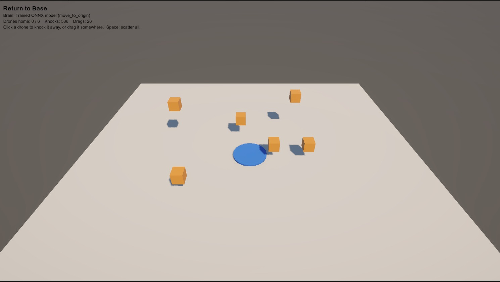
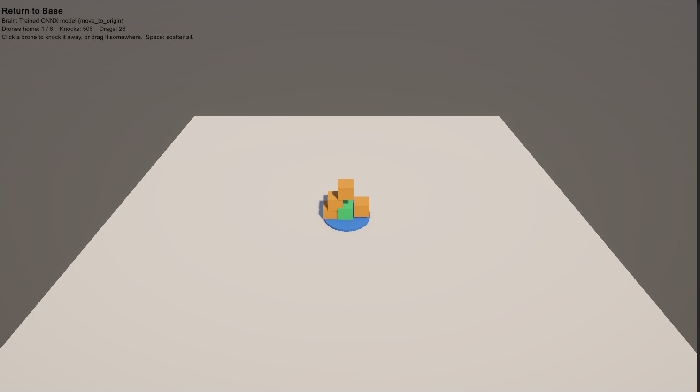
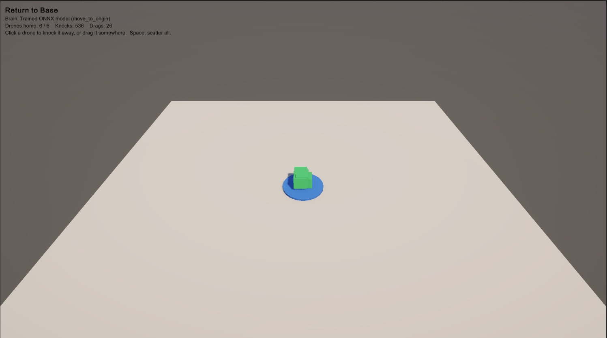

<p align="center">
  
</p>

<div align="center">

[](https://opensource.org/license/MIT)
[](https://discord.gg/amd-dev)
[](https://github.com/psf/black)
[](https://www.python.org/downloads/)
[](https://www.unrealengine.com/download)
[](https://unity.com/download)


</div>

---

**Quick links:** [About](#about-this-project) · [Try the demo](#try-it-the-return-to-base-demo) · [Key use cases](#key-use-cases) · [Unity package (developers)](#unity-package-developers) · [Git/GitHub workflow](#gitgithub-workflow) · [License](#license) · [Unreal setup](#getting-started-unreal)

## About this project

**Schola for Unity** is a course project (CSC301, Team 11 "Oscorp") built with our partner AMD. It ports AMD's open-source **Schola** toolkit from Unreal Engine to **Unity**.

**What is reinforcement learning (RL)?** An agent, such as a game character, learns by trial and error: it gets rewards for useful actions and gradually learns what to do. The result of training is a *model*, a file that can look at a situation and choose an action.

**What Schola does.** Schola already connects Unreal Engine games to popular Python RL tools (Gymnasium, Stable-Baselines3, RLlib). Unity had no equivalent, so Unity developers had to build that connection themselves. Our Unity package lets a developer:

1. describe what an agent can **see** (sensors) and **do** (actuators) in their scene,
2. **train** the agent with Schola's existing Python tools, and
3. **run the trained model inside Unity**, with no Python running.

**Why it matters.** Developers who already use Schola in Unreal can keep the same training tools in Unity, and Unity developers get a ready-made path from "an agent in my scene" to "a trained agent in my game" instead of writing their own integration. It is an alternative to Unity ML-Agents for teams that want Schola's workflow, and it supports AMD's plan to make Schola available across several game engines.

**Where we are.** The *run a trained model* side works end to end and is shown in the demo below. The *train from Unity through Python* connection (gRPC) is not on `main` yet, see [What is included](#what-is--is-not-included-yet). Course planning documents live in [`deliverables/`](deliverables/).

## Try it: the Return to Base demo

There is no website or hosted version: Schola for Unity is a Unity package, so you try it by opening it in the Unity Editor. The demo needs **no Python, no coding and no training**. It shows a model that was trained beforehand steering six drones back to their base.

**You need:** a computer with [Unity Hub](https://unity.com/download) and **Unity 6000.3** (we tested with 6000.3.24f1), [Git](https://git-scm.com/downloads) (or use *Code → Download ZIP* on GitHub), and an internet connection the first time so Unity can download one package.

1. **Get the code.** Run `git clone https://github.com/csc301-2026-f/11-AMD-Schola.git` (or download and unzip the ZIP). Remember where you put the folder.
2. **Create a project.** In Unity Hub choose **New project**, pick the editor 6000.3, a **3D** template, and name it anything (for example `ScholaDemo`).
3. **Add the Schola package.** In Unity open **Window → Package Management → Package Manager**, click **+ → Install package from disk…** and select `Unity/com.amd.schola/package.json` from the folder you downloaded. Wait until the spinner at the bottom right finishes. Keep the downloaded folder where it is.
4. **Add the demo files.** In Unity's **Project** window create a folder `Assets/Demo`, then drag `ReturnToBaseGame.cs` and `move_to_origin.onnx` from [`deliverables/D2/demo/`](deliverables/D2/demo/) into it.
5. **Set up the scene.** Use a scene that has a **Main Camera** and a **Directional Light**. Choose **GameObject → Create Empty**, name it `Demo`, drag `ReturnToBaseGame.cs` onto it, then drag `move_to_origin.onnx` into the component's **Model** field.
6. **Press Play** and click the **Game** tab.

**What you should see:** six orange cube drones start away from a blue base and fly back by themselves. A drone turns **green** when it reaches home, and the on-screen counter goes from `0 / 6` to `6 / 6`. The overlay should read `Brain: Trained ONNX model (move_to_origin)`. If it says `Stand-in policy`, the model is not assigned, so repeat the last part of step 5.

**Things to try:** click a drone to knock it to a random spot, drag a drone and let go, or press **Space** to scatter all drones. The drones always find their way back.

More detail, troubleshooting and a [video walkthrough](https://youtu.be/utxF_vXdSw8) are in the [full demo guide](deliverables/D2/demo/README.md).





## Key use cases

Everything is built around one loop that repeats while the game runs: **observe** (sensors read the game) → **think** (the model chooses an action) → **act** (actuators change the game).

| # | Use case | What a developer does | Status |
| --- | --- | --- | --- |
| 1 | **Define what an agent sees** (US1) | Add a `ScholaAgent` and sensors such as `PositionSensor`. Observations are read fresh from the scene and keep a consistent format. | Done |
| 2 | **Apply an agent's actions** (US2) | Add actuators such as `TranslateActuator`. Valid actions move the object, and invalid actions are rejected with a clear error. | Done |
| 3 | **Control training episodes** (US3) | Use `ScholaEnvironment` to report rewards, episode endings (terminated or truncated) and resets, so an agent can learn from repeated attempts. | Done locally; not yet connected to Python |
| 4 | **Train through Schola** (US4) | Connect the Unity environment to Schola's Python tools over gRPC and run a short training. | **Not on `main` yet.** A first attempt was merged and then reverted; work continues on separate branches |
| 5 | **Run a trained policy** (US5) | Load an ONNX model with `SentisPolicy` (Unity Inference Engine). `SimpleStepper` and `StepperRunner` repeat observe, think, act for every agent. A model whose names or shapes do not fit the agent is rejected with a clear error. | Working. The Return to Base demo shows it with Python closed |
| 6 | **Set up and try the package** (US6) | Follow a guide and sample scene to install the package and use a trained model. | In progress. The [demo guide](deliverables/D2/demo/README.md) is the first version |

Typical developer path once training is connected: build the agent (1, 2), define rewards and resets (3), train in Python (4), export an ONNX model, then run it in the game (5).

## Unity package (developers)

Package path: [`Unity/com.amd.schola`](Unity/com.amd.schola) (`com.amd.schola`, Unity **6000.3**). It depends on `com.unity.ai.inference` and `com.unity.test-framework`.

### Install into a Unity project

1. Install **Unity 6000.3** (team CI uses **6000.3.24f1**; other 6000.3.x patches usually work for local work).
2. Create an empty 3D project in Unity Hub.
3. **Window → Package Management → Package Manager** → **+** → **Install package from disk…** → select `Unity/com.amd.schola/package.json` from this checkout.
4. Wait for import/compile to finish. **AMD Schola** should appear under Package Manager → **In Project**.

Keep the repo checkout in place while the package is installed from disk. Pushing a `unity-v<version>` tag publishes a GitHub Release with an installable tarball (see [workflow](#gitgithub-workflow)); no release has been published yet.

### Run EditMode tests

1. In the consumer project's `Packages/manifest.json`, add (alongside `dependencies`):

```json
"testables": [ "com.amd.schola" ]
```

2. **Window → Analysis → Test Runner** (or search "Test Runner") → **EditMode**.
3. Expand **AMD.Schola.Tests.EditMode** and **Run All**.

These tests exercise sensors/observations, actuators/actions, `ScholaEnvironment` episode hooks, `SentisPolicy` with a CartPole ONNX model, and the observe, think, act stepper. Some tests intentionally log errors to verify failure handling; green checks in Test Runner are what matter.

### What is / is not included yet

| Available on `main` | Not finished yet |
| --- | --- |
| Runtime agents, sensors, actuators, spaces/points | Unity gRPC training server ↔ Schola Python (US4) |
| Local episode/env APIs (`ScholaEnvironment`) | Packaged Setup Demo sample and full setup guide (US6); today the demo files live in [`deliverables/D2/demo/`](deliverables/D2/demo/) |
| ONNX inference (`SentisPolicy`) and steppers (`SimpleStepper`, `StepperRunner`) | Headless smoke player project for CI build/run jobs |
| Return to Base demo with a trained ONNX model | |
| CI/CD: tests, formatting, meta-file checks, codegen check, release workflow | |

Training notes and codegen for Unity C# bindings: [`Unity/com.amd.schola/Training/README.md`](Unity/com.amd.schola/Training/README.md). CI workflows live under [`.github/workflows/`](.github/workflows/).

## Git/GitHub workflow

We forked AMD's open-source Schola repository into our course organization, and all work happens in that fork. The process is:

1. **Track the work.** Each task is a card on our shared Trello board (lists: *Backlog → Ready → In Progress → In Review → Done*). Each card has one owner and acceptance criteria copied from its user story (US1-US6).
2. **Branch from `main`.** One short-lived branch per task, named after the story or task, for example `US5-inference-stepper`, `feature/us2-apply-agent-actions` or `CICD-task8`. Nobody commits directly to `main`.
3. **Commit with Conventional Commits.** For example `feat(unity): add StepperRunner to drive a stepper each frame`.
4. **Open a pull request into `main`** and fill in the [PR template](.github/pull_request_template.md): what changed, how it was tested, and a checklist. The PR **title** must start with one of `feat`, `fix`, `docs`, `test`, `refactor`, `build`, `chore` or `ci`, and CI checks it.
5. **Get a teammate's review.** Every PR needs at least one reviewer who is not the author, including for AI-assisted code. The author must be able to explain every change. Review comments are fixed on the same branch.
6. **Automated checks must pass** (GitHub Actions, summarised by one `ci-ok` job):
   - C# formatting with CSharpier, Unity `.meta` file completeness, package manifest and PR-title checks,
   - Unity EditMode tests, run with GameCI,
   - Python regression tests, a protobuf-to-C# codegen check, and an end-to-end smoke test against a mock server.
7. **Merge into `main`** with the GitHub *Merge pull request* button once the review is approved and checks are green. If a merge turns out to be wrong, we revert it with a new PR rather than rewriting history.
8. **Release.** The version lives in `Unity/com.amd.schola/package.json`. Pushing a tag such as `unity-v0.1.0` runs a workflow that checks the tag matches that version, runs the Unity tests, and publishes a GitHub Release with the package tarball.

New source files carry AMD's copyright header, and every new Unity file or folder is committed together with its `.meta` file. More detail is in [CONTRIBUTING.md](CONTRIBUTING.md).

## License

This project is released under the **MIT License**. See [LICENSE.txt](LICENSE.txt) (Copyright (c) 2023-2026 Advanced Micro Devices, Inc.).

**Why MIT:**
- Upstream Schola is MIT-licensed. Our work is a fork and extension of it, so we keep the same license and copyright notice.
- At our 1 October 2026 meeting, AMD's representative said the proposed work is acceptable under the MIT license, and AMD anticipated that it could later be merged back into the upstream repository with contributor attribution.
- It is permissive: studios and researchers can use, modify and ship Schola for Unity in their own games and tools, with no extra obligations beyond keeping the notice.
- Our [planning document](deliverables/D1/planning.md) records that the code is open source under MIT and can be shared publicly. By contributing, you agree that your contributions are licensed under the same terms.

Third-party dependencies such as Unity Inference Engine, gRPC and Protobuf keep their own licenses.

## Getting Started (Unreal)

### Install Unreal Engine
As the upstream Schola plugin is an Unreal Engine project, you will need to first install Unreal Engine. Refer to the below table to identify the correct version of Unreal Engine for each version of Schola. 

>[!NOTE]
> Each Schola release may be compatible with other versions of Unreal Engine beyond the ones listed here, however these are the version(s) tested for each release.

| Schola version | Unreal Version |
| -------------- | -------------- |
| **2.1** | **5.5-5.7** |
| 2.0 | 5.5-5.6 |
| 1.3 | 5.5-5.6 |
| 1.2 | 5.5 |
| 1.1 | 5.5 |
| 1.0 | 5.4 |


### Installing Schola Into Your Unreal Project
To use the Unreal plugin in an existing Unreal Engine project, copy this repository to the `/Plugins` folder of your project, and pip install the Schola python package in `/Resources/python` using `pip install -e <path-to-plugin>/Resources/python[all]` (the folder that contains `pyproject.toml`). For Unity, see [Unity package](#unity-package-developers) above.

> [!IMPORTANT]
> Since Schola is provided as C++ source you must recompile your project after adding it. Otherwise, you will receive a warning about Schola being built for another version of Unreal Engine regardless of what version you are using.

### Dependencies

#### Python

See `Resources/python/pyproject.toml` for a comprehensive list of dependencies. The following **optional dependency extras** are available when installing with pip (for example `pip install -e ./Resources/python[sb3]`):

| Extra | Description |
| ----- | ----------- |
| `sb3` | Dependencies for running training with Stable Baselines 3 |
| `rllib` | Dependencies for running training with RLlib |
| `minari` | Dependencies for collecting Minari datasets with Schola |
| `all` | Equivalent to installing `sb3`, `rllib`, and `minari` together |
| `docs` | Dependencies for building documentation with Sphinx |

Test dependencies are declared under `[dependency-groups]` in `pyproject.toml`, not as a pip extra. Install them with **`pip install --group test`** (for example `pip install --group test -e ./Resources/python[all]` from your project, or the same with `cd` into `Resources/python` first).

#### C++

All C++ dependencies for using Schola are bundled with the plugin under `/Source/ThirdParty` and do not need to be installed separately. These consist of `gRPC`, `protobuf` and `absl`(dependency of gRPC).

## Build and Test

>[!IMPORTANT]
> Schola comes with all dependencies included. Only run these if you encounter issues during the setup.

### Building Third Party Dependencies

Third party dependencies, specifically gRPC and Protobuf can be built using `Schola\Plugins\Schola\Resources\Build\windows_dependencies.bat` or `Schola\Plugins\Schola\Resources\Build\linux_dependencies.sh` depending on your OS. This will update the plugin ThirdParty folder to include copies of the dependencies including .lib/.a files, and copy protoc, and relevant plugins to the tools directory.

### Generating gRPC/Protobuf Code

To generate code for gRPC and Protobuf run `schola compile-proto`. This will generate `*.pb.cc`, `*.pb.h` and `*.pb.py` files to the correct folders as well as fix several bugs in the default generator (e.g. ignore warnings in C++ code, and fix relative imports for python)

### Generating Documentation

Documentation for Schola is build using a combination of Doxygen + Sphinx + Breathe.

1. Install Doxygen from [the website](https://www.doxygen.nl/) 
2. Install documentation requirements for Schola using pip, for example `pip install -e "./Resources/python[docs]"` from the plugin root (or `pip install -e ".[docs]"` after `cd` into `Resources/python`).
3. Run the command `schola build-docs --builder html` from the root of this project (or supply the path to the plugin folder)

## Contact

For questions about Schola, contact the team at [Schola@amd.com](mailto:Schola@amd.com).

## Contributing

See [CONTRIBUTING.md](CONTRIBUTING.md) for issue and pull request guidelines, coding standards, and testing expectations.

## AI Usage

Claude Opus 5.5  was used to co-develop the Unity Sentis Policy