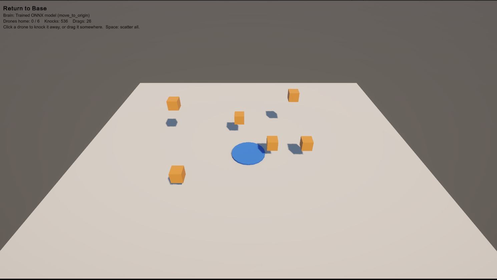
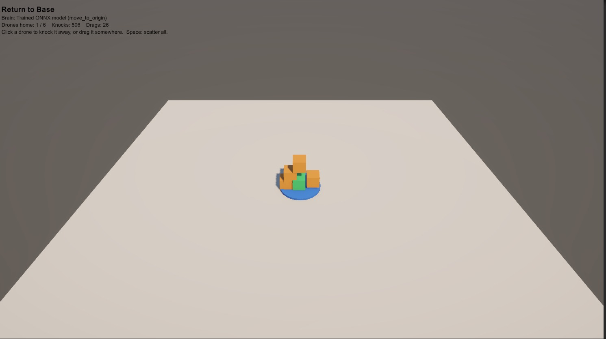
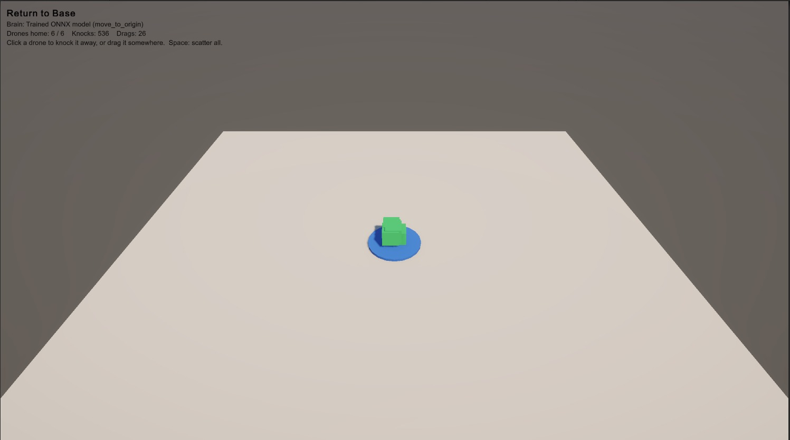

<p align="center">
  
</p>

<div align="center">

[](https://opensource.org/license/MIT)
[](https://discord.gg/amd-dev)
[](https://github.com/psf/black)
[](https://www.python.org/downloads/)
[](https://www.unrealengine.com/download)
[](https://unity.com/download)


</div>

---

Jump to [About](#about-this-project) · [What's new in D3](#whats-new-in-d3) · [Try the demo](#try-the-return-to-base-demo) · [Train and run your own agent](#train-and-run-your-own-agent) · [Key use cases](#key-use-cases) · [Deployment](#deployment) · [Non-functional requirements](#non-functional-requirements) · [Unity package (developers)](#unity-package-developers) · [Git/GitHub workflow](#gitgithub-workflow) · [License](#license) · [Unreal setup](#getting-started-unreal)

## About this project

**Schola for Unity** is a course project (CSC301, Team 11 "Oscorp") built with our partner AMD. It ports AMD's open-source **Schola** toolkit from Unreal Engine to **Unity**.

**What is reinforcement learning (RL)?** An agent, such as a game character, learns by trial and error. It gets rewards for useful actions and gradually learns what to do. The result of training is a *model*, which is a file that looks at a situation and chooses an action.

**What Schola does.** Schola already connects Unreal Engine games to popular Python RL tools such as Gymnasium, Stable-Baselines3 and RLlib. Unity had no equivalent, so Unity developers had to build that connection themselves. With our Unity package, a developer can describe what an agent **sees** (sensors) and **does** (actuators), **train** it with Schola's existing Python tools, and then **run the trained model inside Unity** without Python.

**Why it matters.** Developers who already use Schola in Unreal can keep the same training tools in Unity. Unity developers also get a ready-made path from "an agent in my scene" to "a trained agent in my game" instead of writing their own integration. It is an alternative to Unity ML-Agents for teams that want Schola's workflow, and it supports AMD's plan to make Schola available across several game engines.

**Who it is for.** It is for Unity game developers and RL researchers who use, or want to use, Schola's Python training tools. You do not need to know reinforcement learning to try the demo.

**Where we are.** Both halves now work. An agent can be **trained** from Unity through Schola's Python tools, and the resulting model can then be **run inside Unity** with no Python. Course planning documents live in [`deliverables/`](deliverables/).

## What's new in D3

At D2 (tag `D2`) there was no way to train an agent from Unity. That gap is now closed.

- **Train from Unity (US4).** The `schola unity train` command trains a PPO agent in a running Unity scene with Schola's existing Python tools ([#20](https://github.com/csc301-2026-f/11-AMD-Schola/pull/20)).
- **Train, export and run (US5).** The same command can also save the trained policy as an ONNX file with `--export-onnx`, and the new `PolicyRunner` component runs that file in Unity with Python closed. Model outputs that go past the action limits are now clamped instead of crashing the scene ([#21](https://github.com/csc301-2026-f/11-AMD-Schola/pull/21)).
- **Process.** Every CI job now has a time limit ([#22](https://github.com/csc301-2026-f/11-AMD-Schola/pull/22)).

You can try it in [Train and run your own agent](#train-and-run-your-own-agent) below, which also links a [start-to-finish video walkthrough](https://www.youtube.com/watch?v=TPu1wXgE_mE). The full analysis, including before and after, is in [`deliverables/D3/product-evolution.md`](deliverables/D3/product-evolution.md).

### How we addressed D2 feedback

| Feedback | What we did |
| --- | --- |
| Our D2 review said US4 (training) had not started. | US4 is implemented and merged in [#20](https://github.com/csc301-2026-f/11-AMD-Schola/pull/20). |
| Our D2 review said CI arrived late and some PRs were merged without review. | CI now runs on every PR with time limits. Recent PRs have written descriptions, and PRs [#19](https://github.com/csc301-2026-f/11-AMD-Schola/pull/19), [#20](https://github.com/csc301-2026-f/11-AMD-Schola/pull/20) and [#22](https://github.com/csc301-2026-f/11-AMD-Schola/pull/22) each have a teammate's approval on GitHub. |
| Our D2 review said meeting minutes stopped after 1 October. | Minutes for 3 November are in [`deliverables/team/minutes/`](deliverables/team/minutes/). |
| AMD asked on 3 November for clearer interface names (for example `IReward` and `IEpisodeStatus`). | This is still open and is planned for D4, as recorded in the [minutes](deliverables/team/minutes/26-11-03-minutes.md). |

## Try the Return to Base demo

There is no website or hosted version, because Schola for Unity is a Unity package that you open in the Unity Editor (see [Deployment](#deployment)). The demo needs **no Python, no coding and no training**. It shows a model that was made beforehand steering six drones back to their base.

**You need** a computer with [Unity Hub](https://unity.com/download) and **Unity 6000.3** (CI uses 6000.3.24f1), [Git](https://git-scm.com/downloads) or the *Code → Download ZIP* button on GitHub, and an internet connection the first time so that Unity can download one package.

1. **Get the code.** Run `git clone https://github.com/csc301-2026-f/11-AMD-Schola.git`, or download and unzip the ZIP. Remember where you put the folder.
2. **Create a project.** In Unity Hub choose **New project**, pick the editor 6000.3 and a **3D** template, and give it any name (for example `ScholaDemo`).
3. **Add the Schola package.** In Unity open **Window → Package Management → Package Manager**, click **+ → Install package from disk…** and select `Unity/com.amd.schola/package.json` from the downloaded folder. Wait until the spinner at the bottom right finishes, and keep the downloaded folder where it is.
4. **Add the demo files.** In Unity's **Project** window create a folder `Assets/Demo`, then drag `ReturnToBaseGame.cs` and `move_to_origin.onnx` from [`deliverables/D2/demo/`](deliverables/D2/demo/) into it.
5. **Set up the scene.** Use a scene that has a **Main Camera** and a **Directional Light**. Choose **GameObject → Create Empty**, name it `Demo`, drag `ReturnToBaseGame.cs` onto it, and then drag `move_to_origin.onnx` into the component's **Model** field.
6. **Press Play** and click the **Game** tab.

**What you should see.** Six orange cube drones start away from a blue base and fly back by themselves. Each drone turns **green** when it reaches home, and the on-screen counter goes from `Drones home: 0 / 6` to `6 / 6`. The overlay should read `Brain: Trained ONNX model (move_to_origin)`. If it says `Stand-in policy` instead, the model is not assigned, so repeat the last part of step 5.

**Things to try.** Click a drone to knock it away, drag a drone and let go, or press **Space** to scatter all drones. In every case the drones find their way back.

More detail, troubleshooting and a [video walkthrough](https://youtu.be/utxF_vXdSw8) are in the [full demo guide](deliverables/D2/demo/README.md).





## Train and run your own agent

This is the full workflow added in D3. You train a cube to reach a ball, export what it learned, and then run it with Python closed. It takes about 15 minutes plus a short training run.

**Video walkthrough.** The [D3 demo video on YouTube](https://www.youtube.com/watch?v=TPu1wXgE_mE) shows the whole loop from start to finish. After a short 2,000-step training run, the cube reaches the ball with Python closed. The commands below use 10,000 steps to leave a safer margin, but you can use `--timesteps 2000` to match the video.

**You need** everything from the demo above, plus Python **3.10 to 3.12** and a terminal.

**Step 1. Install.** Install the package in Unity as in steps 1 to 3 of the demo. Then, from the repository root, install the Python tools.

```bash
python -m pip install -e "./Resources/python[sb3]"
```

**Step 2. Train.**
1. In Unity's **Package Manager**, select **AMD Schola** and import the **Training Demo** sample.
2. Choose **Tools → Schola → Create Training Demo Scene** and save the scene. This builds a cube called `Agent`, a ball called `Target`, a camera, a light, and the training components.
3. In **Edit → Project Settings → Player**, turn on **Run In Background** so that Unity keeps working while the terminal has focus.
4. Press **Play** in Unity. The cube now waits for Python.
5. In your terminal, run the command below.

```bash
schola unity train --timesteps 10000 --checkpoint ckpt/unity_ppo --export-onnx
```

The terminal shows training progress while the cube moves. In our recorded run 2,000 steps were enough for the cube to learn to reach the ball, although results can vary between runs. When training finishes, the terminal prints `Saved Unity policy to ckpt/unity_ppo` and `Exported ONNX policy to ckpt/unity_ppo.onnx`.

**Step 3. Run what it learned, with Python closed.**
1. Stop Play Mode and close the terminal.
2. Drag `ckpt/unity_ppo.onnx` into the Unity **Project** window.
3. Select a GameObject and click **Add Component**. Search for **Policy Runner**, which also adds a Stepper Runner automatically. Add the `Agent` cube's `ScholaAgent` to its **Agents** list, and then drag the `.onnx` file into **Model**.
4. Press **Play**. The model now controls the cube with no Python running. If the model does not fit the agent, for example because its input or output names or sizes differ, the Console explains why instead of failing silently.

Keep in mind that training handles about one step per Unity frame, so it is slow, and that it supports one agent per environment. More options and limits are in the [training guide](Unity/com.amd.schola/Documentation~/training.md).

### Configuration

There are no API keys or accounts to set up. The settings below are the only ones, none of them is a secret, and the defaults work if you change nothing.

| Setting | Default | Where to change it |
| --- | --- | --- |
| Unity training server port | `8001`, loopback only | **Port** on the **Training Server** component, and `--unity-port` on the command |
| Python adapter port | `8000` for `schola unity bridge` (`schola unity train` picks a free port) | `--port` on `schola unity bridge` |
| Request timeout | 30 seconds | **Request Timeout Seconds** on the Training Server, and `--timeout` on the command |
| Training length and seed | `--timesteps 10000` and `--seed 0` | Command options |
| Model files | `ckpt/unity_ppo.zip` and `ckpt/unity_ppo.onnx` | `--checkpoint` and `--onnx-path` |
| CI secrets (maintainers only) | `UNITY_LICENSE`, `UNITY_EMAIL` and `UNITY_PASSWORD` | GitHub repository secrets, and their values are never committed |

## Key use cases

Everything is built around one loop that repeats while the game runs. Sensors **observe** the game, the model **thinks** and chooses an action, and actuators **act** on the game.

| # | Use case | What a developer does | Status |
| --- | --- | --- | --- |
| 1 | **Define what an agent sees** (US1) | Add a `ScholaAgent` and sensors such as `PositionSensor`. Observations are read fresh from the scene each time and keep a consistent format. | Done |
| 2 | **Apply an agent's actions** (US2) | Add actuators such as `TranslateActuator`. Valid actions move the object, and invalid actions are rejected with a clear error. | Done |
| 3 | **Control training episodes** (US3) | Use `ScholaEnvironment` to report rewards, episode endings (terminated or truncated) and resets, so that an agent can learn from repeated attempts. | Done, and reused by the training connection |
| 4 | **Train through Schola** (US4) | Run `schola unity train` against a running scene, and add `--export-onnx` to save the result as an ONNX model. | New in D3, for one agent per environment with Transform-based movement |
| 5 | **Run a trained policy** (US5) | Add a `PolicyRunner` component, or use `SentisPolicy` with `SimpleStepper` and `StepperRunner` directly. A model whose names or sizes do not fit the agent is rejected with a clear message, and outputs past the action limits are clamped. | Working, both with the demo model and with a model you train |
| 6 | **Set up and try the package** (US6) | Follow a guide and sample scene to install the package and use a trained model. | In progress, and the [demo guide](deliverables/D2/demo/README.md) is the first version |

A typical developer builds the agent (1 and 2), defines rewards and resets (3), trains in Python and exports an ONNX model (4), and then runs it in the game (5).

**If you are evaluating the project**, start with the [Return to Base demo](#try-the-return-to-base-demo) for a five-minute look at a finished result. Then follow [Train and run your own agent](#train-and-run-your-own-agent) for the new D3 workflow, and finally [run the tests](#run-the-tests) to check engineering quality.

## Deployment

**There is no deployed URL.** Schola for Unity is a library that runs inside a developer's own Unity Editor and Python environment, so there is no website or server to host. What a user installs is the package itself, and the fastest way to evaluate it is the local setup in [Try the Return to Base demo](#try-the-return-to-base-demo). The demo model and the Training Demo scene builder act as seed data, so nothing has to be created by hand.

The package can be shared in two ways.
- **Install from disk.** This is the supported route for evaluation, and it points Unity's Package Manager at `Unity/com.amd.schola/package.json`.
- **GitHub Release.** Pushing a tag such as `unity-v0.1.0` runs [`release.yml`](.github/workflows/release.yml), which checks that the tag matches `package.json`, runs the Unity tests and publishes an installable tarball. No release has been published yet.

Merging to `main` runs the full CI checks but does not publish anything yet, because publishing is a deliberate step that happens with a version tag.

## Non-functional requirements

Schola for Unity is a developer package rather than a web app, so we applied the standards for APIs and backends, which are input validation, clear errors and secure communication. We also looked at basic accessibility for the one piece of UI we ship.

| Area | What we did | Where to see it in the code |
| --- | --- | --- |
| **Input validation** | Every action from Python is checked against the declared action space before anything in the scene moves. Keys, shapes and limits must match, and NaN or infinite numbers are rejected. Messages are limited to 4 MiB and value trees to 10,000 nodes. `TranslateActuator.MaxDisplacement` sets the allowed movement range, and model outputs past the limits are clamped. | `Training/TrainingWire.cs`, `Runtime/Actuators/TranslateActuator.cs`, `Inference/SentisPolicy.cs`, with tests in `Tests/Training` and `Tests/EditMode/Policies` |
| **Meaningful errors** | Unity reports a failure as a short message rather than a stack trace, and the Python adapter turns it into a matching gRPC status such as "invalid argument" or "deadline exceeded". A model that does not fit an agent, or a `PolicyRunner` with no agent or model, logs what is wrong and stops cleanly. After a failed step the environment must be reset, so training never continues from a half-applied step. | `Resources/python/schola/unity/bridge.py`, `Training/TrainingSession.cs`, `Inference/PolicyRunner.cs` |
| **Secure communication** | Both servers listen on `127.0.0.1` only, the gRPC server uses local credentials, one trainer connects at a time, and every exchange has a timeout. Nothing is sent over the internet. | `Training/TrainingServer.cs`, `bridge.py` |
| **Secrets** | The repository contains no keys or passwords, and CI reads the Unity license from GitHub secrets rather than from workflow files. | [Configuration](#configuration), `.github/workflows/` |
| **Reliability** | Scene changes run only on Unity's main thread. When an exchange fails, the Python side closes the connection so that a late reply is never mistaken for the next answer. Stopping Play Mode also releases all queued work. | `Training/TrainingServer.cs`, `bridge.py`, `Tests/Training/TrainingServerTests.cs` |
| **Production-readiness** | Every GitHub Actions job has a time limit, and CI runs formatting, `.meta`-file, Unity, Python and codegen checks on every pull request. There are 76 Unity tests and 10 Python test functions for the training adapter. | `.github/workflows/`, [Run the tests](#run-the-tests) |
| **Accessibility** | There is no end-user UI to audit with Lighthouse. The demo overlay is the only on-screen UI, and it never relies on colour alone, because a text counter shows how many drones are home as well as the green colour. README images have alt text. We have not yet tested with assistive tools. | `deliverables/D2/demo/ReturnToBaseGame.cs` |

There are still known limits. Training handles about one step per Unity frame, it supports one agent per environment, and it has not been tested in a built player (IL2CPP).

## Unity package (developers)

The package lives in [`Unity/com.amd.schola`](Unity/com.amd.schola) as `com.amd.schola` for Unity **6000.3**, and it depends on `com.unity.ai.inference` and `com.unity.test-framework`.

### Install into a Unity project

1. Install **Unity 6000.3**. CI uses **6000.3.24f1**, and other 6000.3 patches usually work locally.
2. Create an empty 3D project in Unity Hub.
3. Open **Window → Package Management → Package Manager**, click **+ → Install package from disk…**, and select `Unity/com.amd.schola/package.json` from this checkout.
4. Wait for the import to finish. **AMD Schola** should then appear under **In Project** in the Package Manager.

Keep the checkout in place while the package is installed from disk. Pushing a `unity-v<version>` tag publishes a GitHub Release with an installable tarball (see [Deployment](#deployment)), but no release has been published yet.

### Run the tests

**Unity tests.** There are 76 tests, in the `AMD.Schola.Tests.EditMode` and `AMD.Schola.Tests.Training` assemblies.

1. In the project's `Packages/manifest.json`, add the line below next to `dependencies`.

```json
"testables": [ "com.amd.schola" ]
```

2. Open **Window → Analysis → Test Runner** (or search for "Test Runner") and choose **EditMode**.
3. Click **Run All**.

The tests cover sensors and observations, actuators and actions (including bad values), `ScholaEnvironment` rewards, endings and resets, `SentisPolicy` and `PolicyRunner` with ONNX models, the observe, think and act stepper, and the training server and session. Some tests log errors on purpose to check failure handling, so what matters is that every test shows a green check.

**Python tests.** From the repository root, install the test tools the same way CI does and then run the tests.

```bash
python -m pip install --group Resources/python/pyproject.toml:test -e "./Resources/python[sb3]"
python -m pytest Test/unity --confcutdir=Test/unity --import-mode=importlib -n 0 --timeout=60
```

The tests that need a live Unity Editor skip themselves when none is running, so this command works anywhere. Setup for the live tests is in the [training guide](Unity/com.amd.schola/Documentation~/training.md#verification).

Both test suites also run automatically on every pull request (see [Git/GitHub workflow](#gitgithub-workflow)).

### Train Unity agents (US4)

The step-by-step guide is in [Train and run your own agent](#train-and-run-your-own-agent). The packaged adapter connects Unity to Schola's existing Python environment wrappers, so nobody has to write a training connection. The [Unity training guide](Unity/com.amd.schola/Documentation~/training.md) covers the separate `schola unity bridge` command, the reset modes and the limits. The current version supports one agent per environment and moves objects directly, which means it does not advance physics between steps.

### What is and is not included yet

| Available on `main` | Not finished yet |
| --- | --- |
| Agents, sensors, actuators, spaces and points | Training with several agents, or with physics between steps |
| Episodes and environments (`ScholaEnvironment`) | A packaged setup sample and full setup guide (US6), since the demo files still live in [`deliverables/D2/demo/`](deliverables/D2/demo/) |
| ONNX inference (`SentisPolicy`, `PolicyRunner`) and steppers (`SimpleStepper`, `StepperRunner`) | A Unity player project for the CI smoke-test build and run jobs |
| The Return to Base demo | Batched inference and the interface renames AMD asked for on 3 November |
| The Unity training server, Python adapter, PPO command, ONNX export and Training Demo (US4 and US5) | Testing the training connection in a built player (IL2CPP) |
| CI with tests, formatting, `.meta`-file and codegen checks, a release workflow and job time limits | Publishing the package automatically when `main` changes, since today it happens on version tags |

Notes on codegen for the Unity C# bindings are in [`Unity/com.amd.schola/Training/README.md`](Unity/com.amd.schola/Training/README.md), and the CI workflows live in [`.github/workflows/`](.github/workflows/).

## Git/GitHub workflow

We forked AMD's open-source Schola repository into our course organization, and all of our work happens in that fork. Each change goes through the steps below.

1. **Track the work.** Each task is a card on our shared Trello board, which moves through *Backlog → Ready → In Progress → In Review → Done*. Each card has one owner and acceptance criteria taken from its user story (US1 to US6).
2. **Branch from `main`.** Each task gets one short-lived branch named after the story or task, for example `US5-inference-stepper`, `feature/us2-apply-agent-actions` or `CICD-task8`. Nobody commits directly to `main`.
3. **Commit with Conventional Commits,** for example `feat(unity): add StepperRunner to drive a stepper each frame`.
4. **Open a pull request into `main`** and fill in the [PR template](.github/pull_request_template.md) with what changed, how it was tested, and the checklist. The PR **title** must start with `feat`, `fix`, `docs`, `test`, `refactor`, `build`, `chore` or `ci`, and CI checks this.
5. **Get a teammate's review.** Every PR needs at least one reviewer who is not the author, including for AI-assisted code, and the author must be able to explain every change. Review comments are fixed on the same branch.
6. **Pass the automated checks.** GitHub Actions runs the checks below and sums them up in one `ci-ok` job. Every job has a `timeout-minutes` limit, so a stuck job cannot use up shared CI time.
   - C# formatting with CSharpier, Unity `.meta`-file completeness, the package manifest and the PR title
   - Unity EditMode tests, run with GameCI
   - Python regression tests, a protobuf-to-C# codegen check, and an end-to-end smoke test against a mock server
7. **Merge into `main`** with the *Merge pull request* button once the review is approved and the checks are green. If a merge turns out to be wrong, we revert it with a new PR rather than rewriting history.
8. **Release on a version tag rather than on every merge.** The version lives in `Unity/com.amd.schola/package.json`. Pushing a tag such as `unity-v0.1.0` runs a workflow that checks the tag matches that version, runs the Unity tests, and publishes a GitHub Release with the package tarball.

New source files carry AMD's copyright header, and every new Unity file or folder is committed together with its `.meta` file. More detail is in [CONTRIBUTING.md](CONTRIBUTING.md).

## License

This project is released under the **MIT License**. See [LICENSE.txt](LICENSE.txt) (Copyright (c) 2023-2026 Advanced Micro Devices, Inc.).

**Why MIT:**
- Upstream Schola is MIT-licensed. Our work is a fork and extension of it, so we keep the same license and copyright notice.
- At our 1 October 2026 meeting, AMD's representative said the proposed work is acceptable under the MIT license, and AMD anticipated that it could later be merged back into the upstream repository with contributor attribution.
- It is permissive: studios and researchers can use, modify and ship Schola for Unity in their own games and tools, with no extra obligations beyond keeping the notice.
- Our [planning document](deliverables/D1/planning.md) records that the code is open source under MIT and can be shared publicly. By contributing, you agree that your contributions are licensed under the same terms.

Third-party dependencies such as Unity Inference Engine, gRPC and Protobuf keep their own licenses.

## Getting Started (Unreal)

### Unity integration (US6)

The Unity package is in [`Unity/com.amd.schola`](Unity/com.amd.schola), separate from the Unreal plugin described below. Follow the [Unity setup and adaptation guide](Unity/com.amd.schola/Documentation~/setup.md) to install it and import the **Setup Demo**. The demo uses real Schola position observations and sends deterministic actions through `ScholaAgent.Act()` and `TranslateActuator`; it requires neither Python nor a trained model. Unity Editor validation is still required; the guide includes the checklist and current US3–5 limitations.

### Install Unreal Engine
As the upstream Schola plugin is an Unreal Engine project, you will need to first install Unreal Engine. Refer to the below table to identify the correct version of Unreal Engine for each version of Schola. 

>[!NOTE]
> Each Schola release may be compatible with other versions of Unreal Engine beyond the ones listed here, however these are the version(s) tested for each release.

| Schola version | Unreal Version |
| -------------- | -------------- |
| **2.1** | **5.5-5.7** |
| 2.0 | 5.5-5.6 |
| 1.3 | 5.5-5.6 |
| 1.2 | 5.5 |
| 1.1 | 5.5 |
| 1.0 | 5.4 |


### Installing Schola Into Your Unreal Project
To use the Unreal plugin in an existing Unreal Engine project, copy this repository to the `/Plugins` folder of your project, and pip install the Schola python package in `/Resources/python` using `pip install -e <path-to-plugin>/Resources/python[all]` (the folder that contains `pyproject.toml`). For Unity, see [Unity package](#unity-package-developers) above.

> [!IMPORTANT]
> Since Schola is provided as C++ source you must recompile your project after adding it. Otherwise, you will receive a warning about Schola being built for another version of Unreal Engine regardless of what version you are using.

### Dependencies

#### Python

See `Resources/python/pyproject.toml` for a comprehensive list of dependencies. The following **optional dependency extras** are available when installing with pip (for example `pip install -e ./Resources/python[sb3]`):

| Extra | Description |
| ----- | ----------- |
| `sb3` | Dependencies for running training with Stable Baselines 3 |
| `rllib` | Dependencies for running training with RLlib |
| `minari` | Dependencies for collecting Minari datasets with Schola |
| `all` | Equivalent to installing `sb3`, `rllib`, and `minari` together |
| `docs` | Dependencies for building documentation with Sphinx |

Test dependencies are declared under `[dependency-groups]` in `pyproject.toml`, not as a pip extra. Install them with **`pip install --group test`** (for example `pip install --group test -e ./Resources/python[all]` from your project, or the same with `cd` into `Resources/python` first).

#### C++

All C++ dependencies for using Schola are bundled with the plugin under `/Source/ThirdParty` and do not need to be installed separately. These consist of `gRPC`, `protobuf` and `absl`(dependency of gRPC).

## Build and Test

>[!IMPORTANT]
> Schola comes with all dependencies included. Only run these if you encounter issues during the setup.

### Building Third Party Dependencies

Third party dependencies, specifically gRPC and Protobuf can be built using `Schola\Plugins\Schola\Resources\Build\windows_dependencies.bat` or `Schola\Plugins\Schola\Resources\Build\linux_dependencies.sh` depending on your OS. This will update the plugin ThirdParty folder to include copies of the dependencies including .lib/.a files, and copy protoc, and relevant plugins to the tools directory.

### Generating gRPC/Protobuf Code

To generate code for gRPC and Protobuf run `schola compile-proto`. This will generate `*.pb.cc`, `*.pb.h` and `*.pb.py` files to the correct folders as well as fix several bugs in the default generator (e.g. ignore warnings in C++ code, and fix relative imports for python)

### Generating Documentation

Documentation for Schola is build using a combination of Doxygen + Sphinx + Breathe.

1. Install Doxygen from [the website](https://www.doxygen.nl/) 
2. Install documentation requirements for Schola using pip, for example `pip install -e "./Resources/python[docs]"` from the plugin root (or `pip install -e ".[docs]"` after `cd` into `Resources/python`).
3. Run the command `schola build-docs --builder html` from the root of this project (or supply the path to the plugin folder)

## Contact

For questions about Schola, contact the team at [Schola@amd.com](mailto:Schola@amd.com).

## Contributing

See [CONTRIBUTING.md](CONTRIBUTING.md) for issue and pull request guidelines, coding standards, and testing expectations.

## AI Usage

Claude Opus 5.5  was used to co-develop the Unity Sentis Policy
