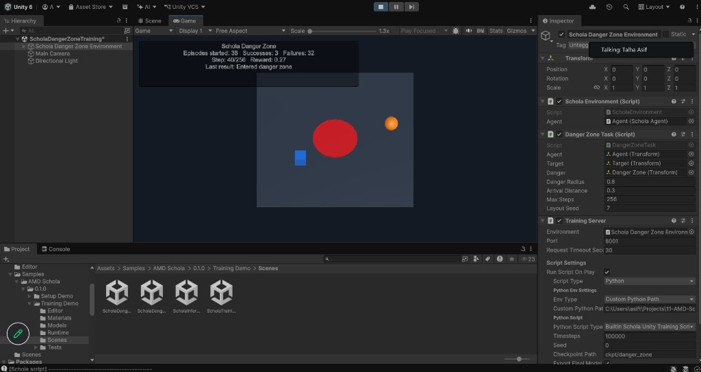
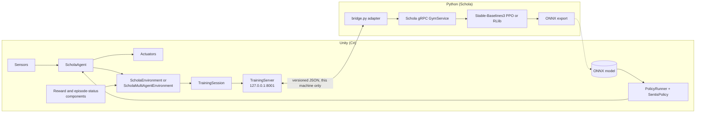

<p align="center">
  
</p>

<div align="center">

[](https://opensource.org/license/MIT)
[](https://discord.gg/amd-dev)
[](https://github.com/psf/black)
[](https://www.python.org/downloads/)
[](https://www.unrealengine.com/download)
[](https://unity.com/download)


</div>

---

Jump to [About](#about-this-project) · [What's new in D4](#whats-new-in-d4) · [Install](#install) · [User flows](#user-flows) · [Key use cases](#key-use-cases) · [How it works](#how-it-works) · [Deployment](#deployment) · [Non-functional requirements](#non-functional-requirements) · [Unity package (developers)](#unity-package-developers) · [Maintaining the project](#maintaining-the-project) · [Git/GitHub workflow](#gitgithub-workflow) · [License](#license) · [Unreal setup](#getting-started-unreal)

## About this project

**Schola for Unity** is a course project (CSC301, Team 11 "Oscorp") built with our partner AMD. It ports AMD's open-source **Schola** toolkit from Unreal Engine to **Unity**.

**What is reinforcement learning (RL)?** An agent, such as a game character, learns by trial and error. It gets rewards for useful actions and gradually learns what to do. The result of training is a *model*, which is a file that looks at a situation and chooses an action.

**What Schola does.** Schola already connects Unreal Engine games to popular Python RL tools such as Gymnasium, Stable-Baselines3 and RLlib. Unity had no equivalent, so Unity developers had to build that connection themselves. With our Unity package, a developer can describe what an agent **sees** (sensors) and **does** (actuators), **train** it with Schola's existing Python tools, and then **run the trained model inside Unity** without Python.

**Why it matters.** Developers who already use Schola in Unreal can keep the same training tools in Unity. Unity developers also get a ready-made path from "an agent in my scene" to "a trained agent in my game" instead of writing their own integration. It is an alternative to Unity ML-Agents for teams that want Schola's workflow, and it supports AMD's plan to make Schola available across several game engines.

**Who it is for.** It is for Unity game developers and RL researchers who use, or want to use, Schola's Python training tools. You do not need to know reinforcement learning to try the demo.

**What already existed and what we built.** AMD's Schola already had the Unreal Engine plugin in `Source/`, the shared protocol files in `Proto/`, and the Python package in `Resources/python/` with its Gymnasium, Stable-Baselines3 and RLlib wrappers. Our team built the Unity package in [`Unity/com.amd.schola`](Unity/com.amd.schola), the Python adapter that lets those existing wrappers talk to Unity (`Resources/python/schola/unity/` and the `schola unity` commands), the Unity and adapter tests, and the CI and release workflows in [`.github/workflows/`](.github/workflows/).

**Where we are.** Both halves of the workflow work. One agent or a whole group of agents can be **trained** from Unity through Schola's Python tools, and the resulting model can then be **run inside Unity** with no Python. Course planning documents live in [`deliverables/`](deliverables/).

## What's new in D4

At D3 (tag `D3`) training worked for one agent at a time and had to be started from a terminal. Both limits are now gone.

- **Several agents in one scene.** `ScholaMultiAgentEnvironment` runs any number of agents, each under its own id, and applies every agent's action before any agent observes ([#28](https://github.com/csc301-2026-f/11-AMD-Schola/pull/28)). `schola unity train` can train these scenes, and the Training Demo sample now includes a two-agent scene ([#32](https://github.com/csc301-2026-f/11-AMD-Schola/pull/32)).
- **Finished agents behave as they do in Unreal.** An agent that finishes early stops moving and keeps reporting its last state, the episode ends only when every agent is done, and an action sent to a finished agent brings it back. This holds in all three of Schola's reset modes ([#32](https://github.com/csc301-2026-f/11-AMD-Schola/pull/32)).
- **Binary choices.** A new MultiBinary space carries on and off values as real booleans instead of zeros and ones in a Box ([#25](https://github.com/csc301-2026-f/11-AMD-Schola/pull/25)).
- **Start training from Unity.** The Training Server can launch the Python trainer itself when you press Play, so no terminal is needed ([#31](https://github.com/csc301-2026-f/11-AMD-Schola/pull/31)).
- **Setup guide and ready-made scenes (US6).** The Training Demo sample now ships training and inference scenes with trained models, including a harder Danger Zone task with randomized episodes, together with a full [setup guide](Unity/com.amd.schola/Documentation~/setup.md) ([#33](https://github.com/csc301-2026-f/11-AMD-Schola/pull/33)).
- **More tests.** CI now runs 136 Unity tests, up from 76 at D3, and the Training Demo sample brings its own tests that run once it is imported.

How the product changed between D2 and D3 is described in [`deliverables/D3/product-evolution.md`](deliverables/D3/product-evolution.md).

### How we addressed feedback

| Feedback | What we did |
| --- | --- |
| AMD (3 November) explained that a Box holding 0 and 1 does not mean the same thing to a trainer as a binary space. | MultiBinary spaces and points now exist on both the Unity and Python sides, and empty or malformed ones are rejected ([#25](https://github.com/csc301-2026-f/11-AMD-Schola/pull/25)). |
| AMD (3 November) recommended that the Gym service collect every environment's state and send it as one batch, rather than each environment submitting state through its own callback. | `TrainingSession` steps the environment, takes one state per agent from the result and returns them together in one response. The training path does not use the `ITrainingStateSink` callback. |
| AMD (3 November) explained why automatic reset matters for vectorized training. | All three reset modes (same step, next step and disabled) are implemented and tested, including in scenes with several agents. |
| AMD (3 November) said truncation limits belong to the environment developer. | Each scene decides when an episode ends through its own `IEpisodeStatus` component, and the package sets no fixed step limit. |
| AMD (3 November) agreed that batched inference could wait. | It is still planned, and `SentisPolicy` runs one agent per call today. |
| Our D2 review said US4 had not started, CI arrived late and some PRs were merged without review. | US4 was merged in [#20](https://github.com/csc301-2026-f/11-AMD-Schola/pull/20) and extended to several agents in [#32](https://github.com/csc301-2026-f/11-AMD-Schola/pull/32). CI runs on every PR with time limits, and every PR follows the [workflow below](#gitgithub-workflow). |

## Install

There is no website or hosted version, because Schola for Unity is a package that you add to a project in the Unity Editor (see [Deployment](#deployment)). These steps take about ten minutes and are the same for every user flow below.

**You need** [Unity Hub](https://unity.com/download) with **Unity 6000.3** (CI uses 6000.3.24f1), [Git](https://git-scm.com/downloads) or the *Code → Download ZIP* button on GitHub, and an internet connection the first time so that Unity can download its dependencies. Training also needs Python **3.10 to 3.12**.

1. **Get the code.** Run `git clone https://github.com/csc301-2026-f/11-AMD-Schola.git`, or download and unzip the ZIP.
2. **Create a project.** In Unity Hub choose **New project**, pick the editor 6000.3 and the **3D (Built-In Render Pipeline)** template, and give the project any name.
3. **Add the package.** In Unity open **Window → Package Management → Package Manager**, click **+ → Install package from disk…**, and select `Unity/com.amd.schola/package.json` from the downloaded folder. When the import finishes, **AMD Schola** appears under **In Project**.
4. **Import the sample.** In the Package Manager, select **AMD Schola**, open **Samples**, and import **Training Demo**. Its files appear under `Assets/Samples/AMD Schola/0.1.0/Training Demo/`.
5. **Install the Python tools.** This is only needed for training. From the root of the downloaded folder, run the command below.

```bash
python -m pip install -e "./Resources/python[sb3]"
python -c "import sys; print(sys.executable)"
```

The second command prints the full path of the Python you just installed into, such as `/Users/you/.venv/bin/python` or `C:\Python312\python.exe`. Copy it, because flow 2 needs it.

Keep the downloaded folder where it is, because Unity reads a package installed from disk from that location. To install without cloning, use the Git URL in [Deployment](#deployment).

## User flows

There are three ways to use the package, from the quickest to the most involved. The first needs no Python, the second goes from training to a working model, and the third trains a group of agents. In the steps below, `Scenes/` means the `Scenes` folder of the imported Training Demo sample.

**Video walkthrough.** The [D4 demo on YouTube](https://youtu.be/BenZPTinDUQ) walks through the package in Unity.



### 1. Try a trained agent (no Python)

This takes about a minute and is the quickest way to check that the install works. Nothing has to be trained, because the sample already contains trained models.

1. Open `Scenes/ScholaInferenceDemo.unity` and press **Play**. The bundled `reach_target.onnx` model moves the blue cube to the orange ball by itself, and the overlay changes to `Target reached` when it arrives. While it is still moving, you can drag the ball somewhere else and watch the cube follow.
2. For a harder task, open `Scenes/ScholaDangerZoneInference.unity` and press **Play**. The agent heads for a target while steering around a red circle, a new layout starts after every attempt, and a panel counts successes and failures.

| Scene in `Scenes/` | What it shows |
| --- | --- |
| `ScholaInferenceDemo.unity` | The bundled `reach_target.onnx` model moves a blue cube to an orange ball with no Python running, and an overlay announces when it arrives. This is the quickest way to check that the install works. |
| `ScholaTrainingDemo.unity` | The same task, ready to be trained as described in [flow 2](#2-train-and-run-your-own-agent). |
| `ScholaDangerZoneTraining.unity` | A harder task, where the agent must reach a target while avoiding a red circle. Start and target positions change every episode, and an on-screen panel counts successes and failures. |
| `ScholaDangerZoneInference.unity` | The bundled `danger_zone.onnx` model playing the Danger Zone task. On 100 random layouts drawn with a different seed from training, it reached the target 80 times. |

The [setup guide](Unity/com.amd.schola/Documentation~/setup.md) covers requirements, installing from a Git URL, adapting the scenes to your own objects, and troubleshooting. The [Danger Zone guide](Unity/com.amd.schola/Documentation~/danger-zone.md) explains that task's rewards, randomized resets and scene wiring. The samples are tested with the Built-In render pipeline, so URP and HDRP projects need their own materials.

### 2. Train and run your own agent

This is the main workflow. You train a cube to reach a ball, save what it learned straight into your project, and then run it with Python closed. It takes about 15 minutes plus a short training run, and it needs step 5 of [Install](#install).

**Step 1. Prepare the scene.**
1. Open `Scenes/ScholaTrainingDemo.unity`. It holds a cube called `Agent`, a ball called `Target`, a camera, a light, and the training components. You can rebuild it at any time with **Tools → Schola → Create Training Demo Scene**.
2. In **Edit → Project Settings → Player**, turn on **Run In Background** so that training keeps going when Unity is not the focused window.

**Step 2. Train from the Training Server panel.** Everything is set in the Inspector, so no terminal is needed. The screenshot above shows the same panel on the Danger Zone scene.
1. Select the `Schola Training Environment` object and find its **Training Server** component in the Inspector. Tick **Run Script On Play**.
2. Under **Python Env Settings**, set **Env Type** to **Custom Python Path**, and paste the path you copied in step 5 of [Install](#install) into **Custom Python Path**.
3. Leave **Python Script Type** on **Builtin Schola Unity Training Script** and **Timesteps** on 10000. Keep **Export Final Model To Onnx** ticked, and set **Onnx Path** to `Assets/Models/cube.onnx` so that the model is saved inside your project.
4. Press **Play**. Unity starts the Python trainer by itself, the cube starts moving while it learns, and the Console shows the training output with a `[Schola script]` prefix. When training finishes, the Console shows `Saved Unity policy to ckpt/unity_ppo` and `Exported ONNX policy to Assets/Models/cube.onnx`. Both paths are relative to the Unity project folder, so the checkpoint lands in a `ckpt` folder next to `Assets`. Stopping Play Mode early also stops the trainer.

**Step 3. Run what it learned, with Python closed.**
1. Stop Play Mode. `Assets/Models/cube.onnx` appears in the **Project** window, and if it does not, choose **Assets → Refresh**.
2. Open `Scenes/ScholaInferenceDemo.unity`, select `Schola Training Environment`, and drag `cube.onnx` into the **Model** field of its **Policy Runner**. In your own scene you would instead click **Add Component**, add a **Policy Runner** (which also adds a Stepper Runner), put the agent's `ScholaAgent` in its **Agents** list, and assign the model.
3. Press **Play**. Your model now controls the cube with no Python running. If the model does not fit the agent, for example because its input or output names or sizes differ, the Console explains why instead of failing silently.

### 3. Train several agents at once

1. Choose **Tools → Schola → Create Multi-Agent Training Demo Scene** and save the scene. It builds two cubes, each with its own ball, under one `ScholaMultiAgentEnvironment`.
2. Turn on **Run In Background**, set up the scene's **Training Server** exactly as in step 2 of flow 2, and press **Play**.

Both cubes share one policy while they train. This works because they see and act in the same way and their episodes end on the same step. When agents differ, or finish at different times, train them with RLlib through `schola unity bridge` as described in the [training guide](Unity/com.amd.schola/Documentation~/training.md#multi-agent-training).

Keep in mind that training handles about one step per Unity frame, so it is slow, and that it moves objects directly instead of simulating physics. More options and limits are in the [training guide](Unity/com.amd.schola/Documentation~/training.md).

### Configuration

There are no API keys or accounts to set up. The settings below are the only ones, none of them is a secret, and the defaults work if you change nothing.

| Setting | Default | Where to change it |
| --- | --- | --- |
| Unity training server port | `8001`, loopback only | **Port** on the **Training Server** component, and `--unity-port` on the command |
| Python adapter port | `8000` for `schola unity bridge` (`schola unity train` picks a free port) | `--port` on `schola unity bridge` |
| Request timeout | 30 seconds | **Request Timeout Seconds** on the Training Server, and `--timeout` on the command |
| Launch the trainer on Play | Off | **Run Script On Play** and **Python Env Settings** on the Training Server |
| Training length and seed | 10000 timesteps and seed 0 | **Timesteps** and **Seed** on the Training Server, or `--timesteps` and `--seed` on the command |
| Model files | `ckpt/unity_ppo.zip` and `ckpt/unity_ppo.onnx` | **Checkpoint Path** and **Onnx Path** on the Training Server, or `--checkpoint` and `--onnx-path` on the command |
| CI secrets (maintainers only) | `UNITY_LICENSE`, `UNITY_EMAIL` and `UNITY_PASSWORD` | GitHub repository secrets, and their values are never committed |

## Key use cases

Everything is built around one loop that repeats while the game runs. Sensors **observe** the game, the model **thinks** and chooses an action, and actuators **act** on the game.

| # | Use case | What a developer does | Status |
| --- | --- | --- | --- |
| 1 | **Define what an agent sees** (US1) | Add a `ScholaAgent` and sensors such as `PositionSensor`. Observations are read fresh from the scene each time and keep a consistent format. | Done |
| 2 | **Apply an agent's actions** (US2) | Add actuators such as `TranslateActuator`. Valid actions move the object, and invalid actions are rejected with a clear error. | Done |
| 3 | **Control training episodes** (US3) | Use `ScholaEnvironment` for one agent, or `ScholaMultiAgentEnvironment` for several, to report rewards, episode endings (terminated or truncated) and resets, so that agents can learn from repeated attempts. | Done for one or many agents |
| 4 | **Train through Schola** (US4) | Tick **Run Script On Play** on the Training Server and press Play, and Unity starts Schola's Python trainer and saves the result as an ONNX model. Developers who prefer a terminal can run `schola unity train` instead. | Done for one or many agents with Transform-based movement |
| 5 | **Run a trained policy** (US5) | Add a `PolicyRunner` component, or use `SentisPolicy` with `SimpleStepper` and `StepperRunner` directly. A model whose names or sizes do not fit the agent is rejected with a clear message, and outputs past the action limits are clamped. | Done, both with the bundled models and with a model you train |
| 6 | **Set up and try the package** (US6) | Follow the [setup guide](Unity/com.amd.schola/Documentation~/setup.md), open the ready-made scenes in the Training Demo sample, and adapt them to your own project. | Done, with reach-target and Danger Zone scenes for both training and inference |

A typical developer builds the agent (1 and 2), defines rewards and resets (3), trains in Python and exports an ONNX model (4), and then runs it in the game (5).

**If you are evaluating the project**, follow [Install](#install) and then [try a trained agent](#1-try-a-trained-agent-no-python) for a quick look at a finished result. Next, [train and run your own agent](#2-train-and-run-your-own-agent) for the full workflow, and finally [run the tests](#run-the-tests) to check engineering quality.

## How it works

The package has four layers. Training and inference both build on the agent and episode code but never on each other, so a game that only runs a trained model does not need the training code. The diagram follows a training run from left to right and then the trained model back into the game.



- **Agent layer** in `Runtime/`. `ScholaAgent` combines the readings of its sensors into one named group of observations and passes each part of an action to the matching actuator. Spaces describe the shape of the data (Box, Discrete, MultiBinary and Dict) and points hold actual values, which mirrors Schola's protocol files in `Proto/`.
- **Episode layer** in `Runtime/Environment/`. On reset an environment puts every object back where it started. On each step it applies the actions, asks each agent's reward and episode-status components for results, and then reads fresh observations.
- **Training layer** in `Training/` and `Resources/python/schola/unity/`. `TrainingServer` receives requests on a background thread but hands each one to `TrainingSession` on Unity's main thread, one per frame, because Unity only allows scene changes there. The Python adapter offers Schola's existing gRPC `GymService`, so Schola's trainers work unchanged, and it talks to Unity with small JSON messages. That keeps the Unity package in plain C# with no native gRPC plugin to build for each platform.
- **Inference layer** in `Inference/` and `Runtime/Steppers/`. `PolicyRunner` sets up a `SimpleStepper` that observes, asks `SentisPolicy` to run the ONNX model with Unity's Inference Engine, and acts, once per frame through `StepperRunner`.

The interfaces (`IAgent`, `ISensor`, `IActuator`, `IEnvironment`, `IMultiAgentEnvironment`, `IPolicy` and `IStepper`) follow Unreal Schola's, so someone who knows the Unreal plugin will recognise each piece. A single-agent environment is handed to training as a group of one agent named `SingleAgent`, just as in Unreal, so one training path serves both kinds of scene.

**Tech stack.** The package is C# for Unity 6000.3 and uses Unity Inference Engine 2.6.1 for ONNX models and the Unity Test Framework for tests. The Python side runs on Python 3.10 to 3.12 with Schola's gRPC, protobuf, Gymnasium, Stable-Baselines3 and RLlib support. CI runs on GitHub Actions, with GameCI for the Unity tests.

## Deployment

**There is no website or server.** Schola for Unity is a package that developers add to their own Unity project, so deploying it means making a version available for Unity's Package Manager to install. There are three ways to get it.

| Channel | Who it is for | How to install | When it changes |
| --- | --- | --- | --- |
| Local checkout | Contributors and evaluators | **Install package from disk** and select `Unity/com.amd.schola/package.json` | Whenever you pull |
| Latest `main` | Anyone who wants the newest merged work | **Install package from git URL** with `https://github.com/csc301-2026-f/11-AMD-Schola.git?path=/Unity/com.amd.schola`, adding `#<commit-sha>` at the end to pin one exact commit | On every merge to `main` |
| Versioned release | Users who want a fixed, tested version | The same Git URL ending in `#unity-v<version>`, or the `.tgz` file attached to the GitHub Release | When a maintainer pushes a `unity-v<version>` tag |

The Git URL route was checked by installing a pinned commit into a test project, as recorded in [`validation.md`](Unity/com.amd.schola/Documentation~/validation.md). It downloads the whole repository the first time, which is about 170 MB because it includes the Unreal plugin. Pushing a `unity-v<version>` tag runs [`release.yml`](.github/workflows/release.yml), which checks that the tag matches the version in `package.json`, runs the Unity tests, and only then publishes a GitHub Release with the package file. The steps are in [Releasing a version](#releasing-a-version). No `unity-v` release has been published yet.

The bundled models and the ready-made scenes in the Training Demo sample act as seed data, so nothing has to be created by hand to try the package.

## Non-functional requirements

Schola for Unity is a developer package rather than a web app, so we applied the standards for APIs and backends, which are input validation, clear errors and secure communication. We also looked at basic accessibility for the one piece of UI we ship.

| Area | What we did | Where to see it in the code |
| --- | --- | --- |
| **Input validation** | Every action from Python is checked against the declared action space before anything in the scene moves. Keys, shapes and limits must match, and NaN or infinite numbers are rejected. Actions for unknown or duplicate agents, or a missing action for an agent that is still running, are rejected before any agent moves. Messages are limited to 4 MiB and value trees to 10,000 nodes, and Unity and Python refuse to talk if their message versions differ. `TranslateActuator.MaxDisplacement` sets the allowed movement range, and model outputs past the limits are clamped. | `Training/TrainingWire.cs`, `Runtime/Actuators/TranslateActuator.cs`, `Inference/SentisPolicy.cs`, with tests in `Tests/Training` and `Tests/EditMode/Policies` |
| **Meaningful errors** | Unity reports a failure as a short message rather than a stack trace, and the Python adapter turns it into a matching gRPC status such as "invalid argument" or "deadline exceeded". A model that does not fit an agent, or a `PolicyRunner` with no agent or model, logs what is wrong and stops cleanly. After a failed step the environment must be reset, so training never continues from a half-applied step. | `Resources/python/schola/unity/bridge.py`, `Training/TrainingSession.cs`, `Inference/PolicyRunner.cs` |
| **Secure communication** | Both servers listen on `127.0.0.1` only, the gRPC server uses local credentials, one trainer connects at a time, and every exchange has a timeout. Nothing is sent over the internet. | `Training/TrainingServer.cs`, `bridge.py` |
| **Secrets** | The repository contains no keys or passwords, and CI reads the Unity license from GitHub secrets rather than from workflow files. | [Configuration](#configuration), `.github/workflows/` |
| **Reliability** | Scene changes run only on Unity's main thread. When an exchange fails, the Python side closes the connection so that a late reply is never mistaken for the next answer. Stopping Play Mode releases all queued work and also stops a trainer started by **Run Script On Play**. | `Training/TrainingServer.cs`, `bridge.py`, `Tests/Training/TrainingServerTests.cs` |
| **Production-readiness** | Every GitHub Actions job has a time limit, and CI runs formatting, `.meta`-file, manifest, Unity, Python and codegen checks on every pull request. There are 136 Unity tests, and 32 Python tests for the training adapter. | `.github/workflows/`, [Run the tests](#run-the-tests) |
| **Accessibility** | There is no end-user UI to audit with Lighthouse. The on-screen UI is limited to the sample overlays, which report arrival, success or failure in text rather than through colour alone. README images have alt text. We have not yet tested with assistive tools. | `InferenceDemoStatus.cs` and `DangerZoneTask.cs` in the Training Demo sample |

There are still known limits. Training handles about one step per Unity frame, it does not advance physics between steps, and it has not been tested in a built player (IL2CPP). The full list is in [What is and is not included yet](#what-is-and-is-not-included-yet).

## Unity package (developers)

The package lives in [`Unity/com.amd.schola`](Unity/com.amd.schola) as `com.amd.schola` for Unity **6000.3**, and it depends on `com.unity.ai.inference` and `com.unity.test-framework`. To add it to a project, follow [Install](#install).

### Run the tests

**Unity tests.** There are 136 tests, in the `AMD.Schola.Tests.EditMode` and `AMD.Schola.Tests.Training` assemblies.

1. In the project's `Packages/manifest.json`, add the line below next to `dependencies`.

```json
"testables": [ "com.amd.schola" ]
```

2. Open **Window → Analysis → Test Runner** (or search for "Test Runner") and choose **EditMode**.
3. Click **Run All**.

The tests cover sensors and observations, actuators and actions (including bad values), rewards, endings and resets for single-agent and multi-agent environments, `SentisPolicy` and `PolicyRunner` with ONNX models, the observe, think and act stepper, the training server, session and message format, and the trainer launcher settings. Some tests log errors on purpose to check failure handling, so what matters is that every test shows a green check.

**Python tests.** There are 32 tests for the Unity adapter in `Test/unity/`. From the repository root, install the test tools the same way CI does (this needs pip 25.1 or newer) and then run the tests.

```bash
python -m pip install --group Resources/python/pyproject.toml:test -e "./Resources/python[sb3]"
python -m pytest Test/unity --confcutdir=Test/unity --import-mode=importlib -n 0 --timeout=60
```

Eight of these tests need a live Unity Editor and skip themselves when none is running, so this command works anywhere. Setup for the live tests is in the [training guide](Unity/com.amd.schola/Documentation~/training.md#verification). CI also runs upstream Schola's own Python tests in `Test/core`, `Test/scripts` and `Test/sb3`.

Both test suites also run automatically on every pull request (see [Git/GitHub workflow](#gitgithub-workflow)).

### What is and is not included yet

| Available on `main` | Not finished yet |
| --- | --- |
| Agents with the built-in `PositionSensor` and `TranslateActuator`, and Box, Discrete, MultiBinary and Dict spaces | Custom `ISensor` and `IActuator` classes on a `ScholaAgent`, because the agent only accepts the built-in sensor and actuator today |
| Single-agent and multi-agent environments, with Unreal-style handling of agents that finish early | Training with physics between steps |
| Training from the Training Server panel with **Run Script On Play**, or through `schola unity train` and `schola unity bridge`, with ONNX export | Batched inference, MultiBinary actions in `SentisPolicy`, and the interface renames AMD asked for on 3 November |
| ONNX inference with `SentisPolicy` and `PolicyRunner`, and the steppers `SimpleStepper` and `StepperRunner` | Testing in a built player (IL2CPP), and a Unity player project for the CI smoke-test build and run jobs |
| The [setup guide](Unity/com.amd.schola/Documentation~/setup.md) and the Training Demo sample, with ready-made reach-target and Danger Zone scenes, two bundled models and a two-agent scene builder | Running the sample tests in CI, because CI does not import samples, and sample materials for URP or HDRP projects, since the samples are tested with the Built-In render pipeline |
| CI with tests, formatting, `.meta`-file, manifest, codegen and PR-title checks, a release workflow and job time limits | Publishing the package automatically when `main` changes, since today it happens on version tags |

## Maintaining the project

This section is for whoever continues the project, whether that is AMD or a new team.

### Where things live

| Path | Unity assembly | What it holds |
| --- | --- | --- |
| `Unity/com.amd.schola/Runtime/` | `AMD.Schola.Runtime` | Agents, sensors, actuators, spaces, points, environments and steppers. It depends on nothing else in the package. |
| `Unity/com.amd.schola/Inference/` | `AMD.Schola.Inference` | `SentisPolicy` and `PolicyRunner`, which use Unity Inference Engine |
| `Unity/com.amd.schola/Training/` | `AMD.Schola.Training` | `TrainingServer`, `TrainingSession`, the message format in `TrainingWire.cs`, and the trainer launcher, whose Inspector lives in `Training/Editor/` |
| `Unity/com.amd.schola/Tests/` | `AMD.Schola.Tests.EditMode` and `AMD.Schola.Tests.Training` | The Unity tests |
| `Unity/com.amd.schola/Samples~/TrainingDemo/` | Sample runtime, editor and test assemblies | The Training Demo sample, with its scripts, scene builders, `Scenes/`, `Materials/`, bundled `Models/` and tests. Unity skips folders whose names end in `~` until a user imports the sample, so CI does not build or test this code. |
| `Unity/com.amd.schola/Documentation~/` | None | The [setup guide](Unity/com.amd.schola/Documentation~/setup.md), [training guide](Unity/com.amd.schola/Documentation~/training.md), [Danger Zone guide](Unity/com.amd.schola/Documentation~/danger-zone.md) and the [validation record](Unity/com.amd.schola/Documentation~/validation.md) |
| `Resources/python/schola/unity/` and `Resources/python/schola/scripts/unity.py` | None | The Python adapter and the `schola unity` commands |
| `Test/unity/` | None | Adapter, ONNX export and live Unity tests |
| `.github/workflows/` and `.github/scripts/` | None | CI, the release workflow and the small check scripts they run |
| `deliverables/` | None | Course documents, which are not part of the product |

### Set up a development copy

1. Follow [Install](#install), and add `testables` as shown in [Run the tests](#run-the-tests) so that the package tests appear in Test Runner.
2. Create a Python environment and install the package with its test tools.

```bash
python -m venv .venv
source .venv/bin/activate          # On Windows use .venv\Scripts\Activate.ps1
python -m pip install --group Resources/python/pyproject.toml:test -e "./Resources/python[sb3]"
```

3. Before pushing C# changes, format them with the same CSharpier version as CI. This needs the .NET 8 SDK.

```bash
dotnet tool restore
dotnet csharpier format Unity/
```

Python code follows [Black](https://black.readthedocs.io/), and [CONTRIBUTING.md](CONTRIBUTING.md) has the general coding standards.

### Common changes

- **Add a space or point type.** The MultiBinary change in [#25](https://github.com/csc301-2026-f/11-AMD-Schola/pull/25) is a good template. Add the classes under `Runtime/Spaces/` and `Runtime/Points/`, teach `TrainingWire.cs` to encode, decode and validate the new kind, add the same kind to `_decode_tree` and `_encode_point` in `bridge.py`, and test both sides. If trained models should produce it too, `SentisPolicy` needs a case for it.
- **Change the messages between Unity and Python.** Raise `TrainingWire.Version` and `VERSION` in `bridge.py` together, because each side refuses messages that carry another version.
- **Add a sensor or actuator.** Implement `ISensor` or `IActuator`. A `ScholaAgent` currently stores lists of `PositionSensor` and `TranslateActuator`, so a new type also needs the agent widened to accept the interfaces.
- **Add any Unity file or folder.** Commit the `.meta` file that Unity creates next to it, because CI fails without it.
- **Change a sample scene.** Never edit scene files by hand. Import the sample into a test project, rebuild the scene with its **Tools → Schola** menu item (or run `SetupSceneAssets.Generate` for the two reach-target scenes), save it into the sample's `Scenes/` folder, and copy the scene and material files back into `Samples~/TrainingDemo/` together with their `.meta` files so that references keep working.
- **Replace a bundled model.** Overwrite the `.onnx` file but keep its `.meta` file, and update the training details and SHA-256 hash in the sample's `Models/README.md`. The repository ignores `.onnx` files in general, so a new model file also needs its own exception in `.gitignore`.
- **Test sample changes.** Because CI never imports the sample, import it into a test project with `com.amd.schola` listed in `testables` and run its tests in Test Runner before opening the PR, as described in [`validation.md`](Unity/com.amd.schola/Documentation~/validation.md).

### CI and secrets

The `ci-ok` job sums up every other check, so branch protection on `main` should require only `ci-ok`. The formatting and file checks run on every PR, while the Unity, Python, codegen and smoke-test jobs run only when files they cover change, which keeps CI time low. The Unity tests need three repository secrets, `UNITY_LICENSE`, `UNITY_EMAIL` and `UNITY_PASSWORD`, and anyone who forks or takes over the repository has to add their own, because secrets are not copied with a fork. If a run fails before Unity starts, for example because the GitHub API returned an error, choose **Re-run failed jobs** rather than changing code.

### Releasing a version

1. In a PR, raise `version` in `Unity/com.amd.schola/package.json`, then merge it.
2. Tag that commit on `main` and push the tag, for example `git tag unity-v0.1.0` followed by `git push origin unity-v0.1.0`.
3. The [release workflow](.github/workflows/release.yml) checks the tag, runs the Unity tests and publishes the GitHub Release. A version with a hyphen, such as `0.2.0-beta`, is marked as a pre-release.

### Handing over to AMD

The code is MIT-licensed and lives in a fork of AMD's Schola repository, so AMD can merge `Unity/com.amd.schola`, `Resources/python/schola/unity/` and `Test/unity/` back into upstream Schola. The work we would suggest next, roughly in order of value, is the interface renames AMD asked for, custom sensors and actuators on `ScholaAgent`, a stepper that advances physics between training steps, batched inference, and testing in a built player.

Notes on codegen for the Unity C# bindings are in [`Unity/com.amd.schola/Training/README.md`](Unity/com.amd.schola/Training/README.md).

## Git/GitHub workflow

We forked AMD's open-source Schola repository into our course organization, and all of our work happens in that fork. Each change goes through the steps below.

1. **Track the work.** Each task is a card on our shared Trello board, which moves through *Backlog → Ready → In Progress → In Review → Done*. Each card has one owner and acceptance criteria taken from its user story (US1 to US6).
2. **Branch from `main`.** Each task gets one short-lived branch named after the story or task, for example `US5-inference-stepper`, `feature/us2-apply-agent-actions` or `CICD-task8`. Nobody commits directly to `main`.
3. **Commit with Conventional Commits,** for example `feat(unity): add StepperRunner to drive a stepper each frame`.
4. **Open a pull request into `main`** and fill in the [PR template](.github/pull_request_template.md) with what changed, how it was tested, and the checklist. The PR **title** must start with `feat`, `fix`, `docs`, `test`, `refactor`, `build`, `chore` or `ci`, and CI checks this.
5. **Get a teammate's review.** Every PR needs at least one reviewer who is not the author, including for AI-assisted code, and the author must be able to explain every change. Review comments are fixed on the same branch.
6. **Pass the automated checks.** GitHub Actions runs the checks below and sums them up in one `ci-ok` job. Every job has a `timeout-minutes` limit, so a stuck job cannot use up shared CI time.
   - C# formatting with CSharpier, Unity `.meta`-file completeness, the package manifest and the PR title
   - Unity EditMode tests, run with GameCI
   - Python regression tests, a protobuf-to-C# codegen check, and an end-to-end smoke test against a mock server
7. **Merge into `main`** with the *Merge pull request* button once the review is approved and the checks are green. If a merge turns out to be wrong, we revert it with a new PR rather than rewriting history.
8. **Release on a version tag rather than on every merge.** The version lives in `Unity/com.amd.schola/package.json`. Pushing a tag such as `unity-v0.1.0` runs a workflow that checks the tag matches that version, runs the Unity tests, and publishes a GitHub Release with the package tarball.

New source files carry AMD's copyright header, and every new Unity file or folder is committed together with its `.meta` file. More detail is in [CONTRIBUTING.md](CONTRIBUTING.md).

## License

This project is released under the **MIT License**. See [LICENSE.txt](LICENSE.txt) (Copyright (c) 2023-2026 Advanced Micro Devices, Inc.).

**Why MIT.**
- Upstream Schola is MIT-licensed. Our work is a fork and extension of it, so we keep the same license and copyright notice.
- At our 1 October 2026 meeting, AMD's representative said the proposed work is acceptable under the MIT license, and AMD anticipated that it could later be merged back into the upstream repository with contributor attribution.
- It is permissive, so studios and researchers can use, modify and ship Schola for Unity in their own games and tools with no extra obligations beyond keeping the notice.
- Our [planning document](deliverables/D1/planning.md) records that the code is open source under MIT and can be shared publicly. By contributing, you agree that your contributions are licensed under the same terms.

Third-party dependencies such as Unity Inference Engine, gRPC and Protobuf keep their own licenses.

## Getting Started (Unreal)

### Install Unreal Engine
As the upstream Schola plugin is an Unreal Engine project, you will need to first install Unreal Engine. Refer to the below table to identify the correct version of Unreal Engine for each version of Schola. 

>[!NOTE]
> Each Schola release may be compatible with other versions of Unreal Engine beyond the ones listed here, however these are the version(s) tested for each release.

| Schola version | Unreal Version |
| -------------- | -------------- |
| **2.1** | **5.5-5.7** |
| 2.0 | 5.5-5.6 |
| 1.3 | 5.5-5.6 |
| 1.2 | 5.5 |
| 1.1 | 5.5 |
| 1.0 | 5.4 |


### Installing Schola Into Your Unreal Project
To use the Unreal plugin in an existing Unreal Engine project, copy this repository to the `/Plugins` folder of your project, and pip install the Schola python package in `/Resources/python` using `pip install -e <path-to-plugin>/Resources/python[all]` (the folder that contains `pyproject.toml`). For Unity, see [Install](#install) above.

> [!IMPORTANT]
> Since Schola is provided as C++ source you must recompile your project after adding it. Otherwise, you will receive a warning about Schola being built for another version of Unreal Engine regardless of what version you are using.

### Dependencies

#### Python

See `Resources/python/pyproject.toml` for a comprehensive list of dependencies. The following **optional dependency extras** are available when installing with pip (for example `pip install -e ./Resources/python[sb3]`):

| Extra | Description |
| ----- | ----------- |
| `sb3` | Dependencies for running training with Stable Baselines 3 |
| `rllib` | Dependencies for running training with RLlib |
| `minari` | Dependencies for collecting Minari datasets with Schola |
| `all` | Equivalent to installing `sb3`, `rllib`, and `minari` together |
| `docs` | Dependencies for building documentation with Sphinx |

Test dependencies are declared under `[dependency-groups]` in `pyproject.toml`, not as a pip extra. Install them with **`pip install --group test`** (for example `pip install --group test -e ./Resources/python[all]` from your project, or the same with `cd` into `Resources/python` first).

#### C++

All C++ dependencies for using Schola are bundled with the plugin under `/Source/ThirdParty` and do not need to be installed separately. These consist of `gRPC`, `protobuf` and `absl`(dependency of gRPC).

## Build and Test

>[!IMPORTANT]
> Schola comes with all dependencies included. Only run these if you encounter issues during the setup.

### Building Third Party Dependencies

Third party dependencies, specifically gRPC and Protobuf can be built using `Schola\Plugins\Schola\Resources\Build\windows_dependencies.bat` or `Schola\Plugins\Schola\Resources\Build\linux_dependencies.sh` depending on your OS. This will update the plugin ThirdParty folder to include copies of the dependencies including .lib/.a files, and copy protoc, and relevant plugins to the tools directory.

### Generating gRPC/Protobuf Code

To generate code for gRPC and Protobuf run `schola compile-proto`. This will generate `*.pb.cc`, `*.pb.h` and `*.pb.py` files to the correct folders as well as fix several bugs in the default generator (e.g. ignore warnings in C++ code, and fix relative imports for python)

### Generating Documentation

Documentation for Schola is build using a combination of Doxygen + Sphinx + Breathe.

1. Install Doxygen from [the website](https://www.doxygen.nl/) 
2. Install documentation requirements for Schola using pip, for example `pip install -e "./Resources/python[docs]"` from the plugin root (or `pip install -e ".[docs]"` after `cd` into `Resources/python`).
3. Run the command `schola build-docs --builder html` from the root of this project (or supply the path to the plugin folder)

## Contact

For questions about Schola, contact the team at [Schola@amd.com](mailto:Schola@amd.com).

## Contributing

See [CONTRIBUTING.md](CONTRIBUTING.md) for issue and pull request guidelines, coding standards, and testing expectations.
