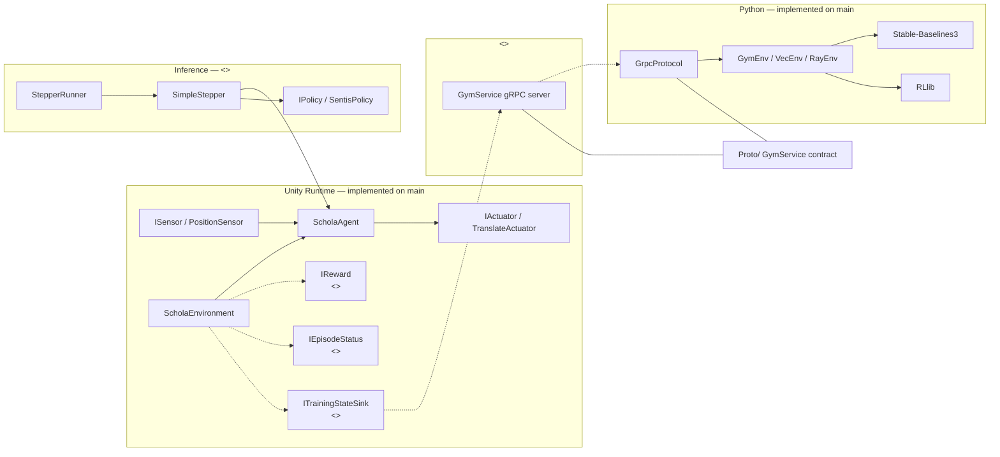
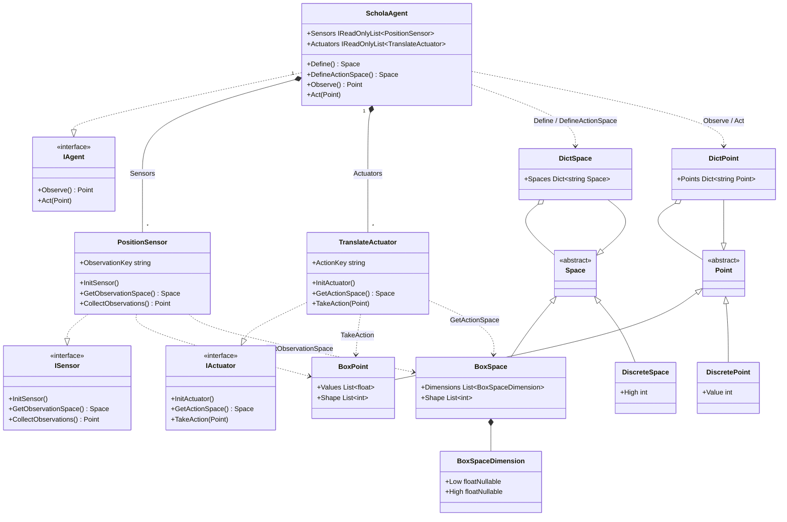
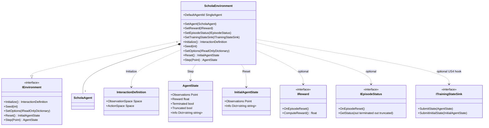
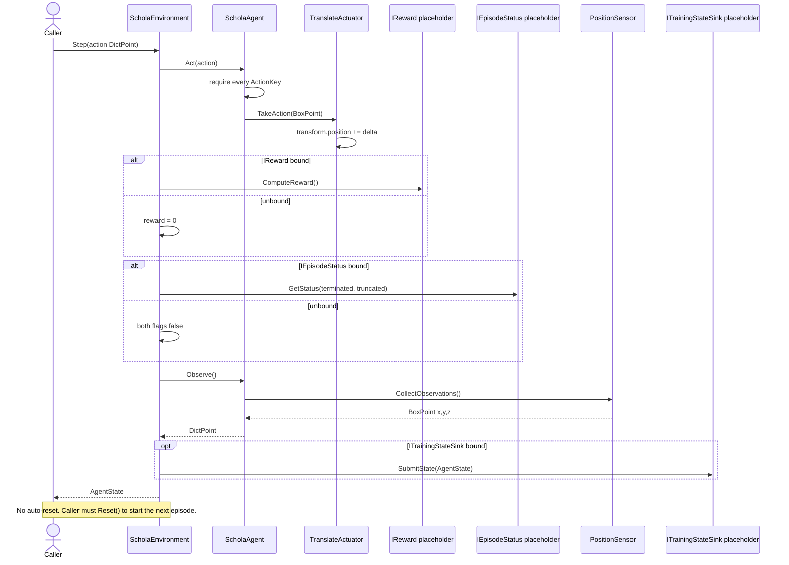
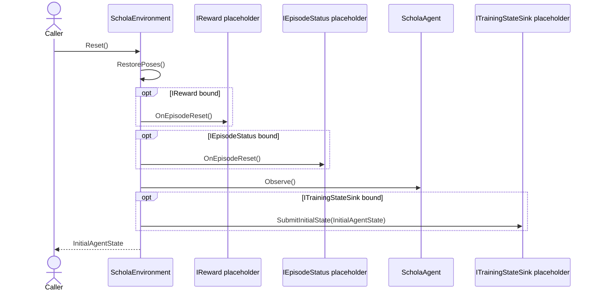
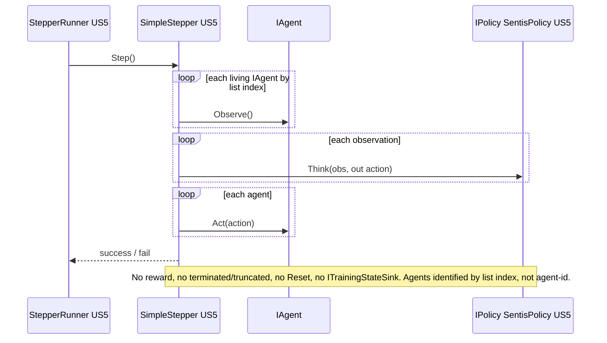
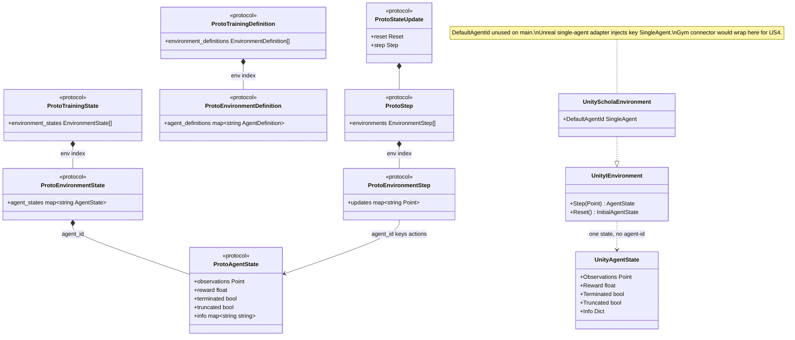
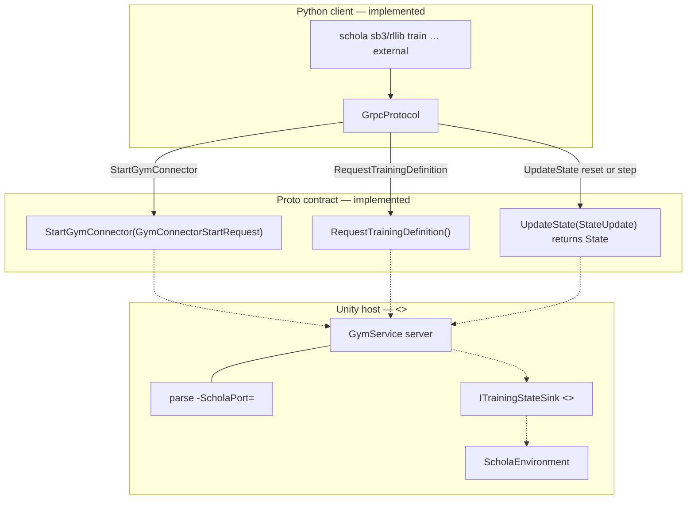
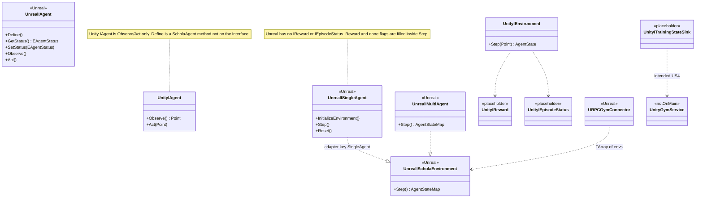

# US1–US4 Unity architecture (UML)
US1 (Observations), US2 (actions), US3(episodes) are implemented. US4 (train through Schola) will be merged soon.

## Legend

Every class, component, and dashed edge uses one of these markers.

| Marker | Mermaid cue | Meaning |
| --- | --- | --- |
| implemented | Solid box, no extra stereotype | Type on `main` with a Runtime or Inference class |
| placeholder | `<<placeholder>>` | Contract on `main`, no Runtime implementation (`IReward`, `IEpisodeStatus`, `ITrainingStateSink`) |
| adjacent | `<<US5>>` | Inference loop. |
| Unreal | `<<Unreal>>` | Comparison type. Not a Unity type |
| not on main | `<<notOnMain>>` | `GymService` host, reverted JSON bridge, `origin/US4` gRPC spike |

Dashed associations mean optional, missing, or not implemented on `main`.

---

## 1. System context

Unity Runtime on `main` can observe, act, and run a local episode. Inference (US5) drives the same `IAgent` without rewards or reset. The Unity gRPC **server** is the missing US4 piece.

Training path expected by existing Python: Unity hosts `GymService`; Python is the client. That server is not on `main`. `ITrainingStateSink` is the US4 hook on the environment; nothing on `main` serializes it to gRPC.

Sources: `Unity/com.amd.schola/Runtime/`, `Unity/com.amd.schola/Inference/`, `Unity/com.amd.schola/Training/README.md`, `Proto/GymConnector.proto`, `Resources/python/schola/`.

---

## 2. Agent composition (US1–US2)

`ScholaAgent` implements `IAgent` and stores **concrete** `List<PositionSensor>` / `List<TranslateActuator>` (exposed as `IReadOnlyList`), not `ISensor` / `IActuator`. A new sensor or actuator type needs a code change on the agent.

Notes, from the types on `main`:

- `Define()` builds a `DictSpace` keyed by `PositionSensor.ObservationKey` (default `"position"`).
- `Observe()` builds a matching `DictPoint` of 3-float world `BoxPoint`s.
- `DefineActionSpace()` builds a `DictSpace` keyed by `TranslateActuator.ActionKey` (default `"translate"`). Duplicate keys warn and last-write-wins.
- `Act(Point)` requires a `DictPoint`, checks **every** actuator key before any `TakeAction`, then applies 3-float `BoxPoint` deltas to `transform.position`. Wrong type or arity throws.
- Unity Point/Space omit proto `MultiDiscrete`, `MultiBinary`, and `Text`. There is no `Space.Contains` / bound enforcement on `main`.
- Unity `IAgent` is Observe/Act only. It has no `Define` / `GetStatus` / `SetStatus` (those exist on Unreal `IAgent`; see diagram 6). `ScholaAgent.Define` is a concrete method, not part of `IAgent`.

Sources: `Runtime/Sensors/`, `Runtime/Actuators/`, `Runtime/Agent/`, `Runtime/Points/`, `Runtime/Spaces/`.

---

## 3. Episode environment (US3)

`ScholaEnvironment` is one env, one `ScholaAgent`. `IEnvironment.Step` takes one `Point` and returns one `AgentState` with no agent-id field. `IReward`, `IEpisodeStatus`, and `ITrainingStateSink` are contracts on `main` with no Runtime class; tests supply fakes.

`IEnvironment` mirrors Unreal `ISingleAgentScholaEnvironment` with C# return values instead of out-params.

Behavior on `main`:

- `Initialize()` inits sensors/actuators, snapshots local poses of the agent hierarchy plus configured actuator transforms, and returns `InteractionDefinition(agent.Define(), agent.DefineActionSpace())`.
- `Step(action)` does `Act` → `ComputeReward` (or `0`) → `GetStatus` (or both flags false) → `Observe` → optional `SubmitState`. It does **not** auto-reset; the caller must `Reset()`.
- `Reset()` calls `Initialize()` if not yet initialized, then restores the initialize snapshot, calls `OnEpisodeReset` on reward/status, observes, and returns `InitialAgentState` (obs + info only). No reward or done flags on reset.
- `Seed` and `SetOptions` are no-ops. `AgentState.Info` is allocated empty and never populated.
- `DefaultAgentId = "SingleAgent"` is declared and unused. Reserved for a future Gym connector wrap that keys proto maps the way Unreal's single-agent adapter does.
- Reward and status may be assigned in the inspector (`GetComponentInChildren`) or via setters. The sink is **not** auto-resolved; it must be `SetTrainingStateSink`.

Sources: `Runtime/Environment/`, `Runtime/TrainingDataTypes/`, `Runtime/Common/InteractionDefinition.cs`.

---

## 4. Dual-loop sequences (US3 vs US5)

Both loops share `IAgent.Observe` / `IAgent.Act`. Only the environment loop has reward, episode flags, reset, and the training-state sink. Inference has none of those.

### Training / episode loop — `ScholaEnvironment.Step`

### Reset — `ScholaEnvironment.Reset`

### Inference loop — `SimpleStepper.Step` (`<<US5>>`)

`SimpleStepper` can drive `IReadOnlyList<IAgent>` with one shared `IPolicy`. That is inference-only multi-agent by index, not a training multi-agent environment.

Sources: `Runtime/Environment/ScholaEnvironment.cs`, `Runtime/Steppers/SimpleStepper.cs`, `Runtime/Steppers/StepperRunner.cs`, `Runtime/Policies/IPolicy.cs`, `Inference/SentisPolicy.cs`.

---

## 5. Protocol nesting vs Unity cardinality (US3–US4)

Proto and Unreal nest `env_id` → `agent_id` → payload. Unity `IEnvironment` is one env, one agent. Python `GymEnv` also assumes 1 env, 1 agent. `GymVectorEnv` / SB3 flatten `(env, agent)` slots; `RayEnv` uses true multi-agent dicts. Unity has no `IMultiAgentEnvironment` and no `map<string, AgentState>`.

| Layer | Environments | Agents per env | How identity is keyed |
| --- | --- | --- | --- |
| Proto `TrainingState` / `TrainingDefinition` | Many (`repeated`) | Many (`map<string, …>`) | env index, then `agent_id` |
| Unreal `IScholaEnvironment` | Connector holds `TArray` of envs | Many (`TMap<FString, …>`) | `agent_id` string |
| Unreal `ISingleAgentScholaEnvironment` | One | One, adapter injects `"SingleAgent"` | injected key |
| Unity `ScholaEnvironment` | One | One | none; `DefaultAgentId` unused |
| Python `GymEnv` | One | One | 1:1 wrap |
| Python `GymVectorEnv` / `sb3.VecEnv` | Many slots | Flattened `(env, agent)`; agents in one env finish together | slot index |
| Python `RayEnv` | Many | True multi-agent dicts | `agent_id` |
| Unity `SimpleStepper` (`<<US5>>`) | N/A | Many `IAgent`s, one `IPolicy` | list index, no episode |

No competitive/cooperative configs exist in Unity.

Sources: `Proto/State.proto`, `Proto/Definitions.proto`, `Proto/StateUpdates.proto`, `Runtime/Environment/IEnvironment.cs`, `Resources/python/schola/gym/env.py`.

---

## 6. US4 target and Unreal delta

### Target training connection (`GymService`)

Python already calls these three RPCs. Unity must host the server. `Training/README.md` specifies generate C# from `Proto/`, host `GymService`, parse `-ScholaPort=`. That host is not on `main`. No generated C# under `Training/Generated/`.

`UpdateState` carries either `Reset` (`map<env_id, EnvironmentSettings>`) or `Step` (`repeated EnvironmentStep`, each `map<agent_id, Point>`). The reply is `State` with either `TrainingState` or `InitialState`. Auto-reset (`AutoResetType`: SAME_STEP / NEXT_STEP / DISABLED) is a connector concern; `ScholaEnvironment` does not auto-reset.

### Unreal comparison (`<<Unreal>>`)

Unreal differences that matter for a Unity Gym connector:

- Unreal `IAgent` also has `Define`, `GetStatus`, `SetStatus`. Unity `IAgent` is Observe/Act only; `ScholaAgent.Define` is concrete.
- Unreal environments fill `FAgentState.Reward` / `bTerminated` / `bTruncated` inside `Step`. They have no `IReward` / `IEpisodeStatus`.
- Unreal `IMultiAgentScholaEnvironment` has **no Unity equivalent**.
- Unreal hosts `GymService` via `URPCGymConnector` / `UCommunicationManager`. Unity does not.

### Reverted and spike US4

These are historical. They are not types on `main`.

1. **`origin/US4`** — native gRPC spike: generated proto C# plus `GymStartupServer` implementing `StartGymConnector` only. Step/reset unimplemented.
2. **PR #17 / `8fe1ddb` (reverted by PR #18 / `547a9f4`)** — custom loopback TCP + JSON (`TrainingServer`, `TrainingSession`, `TrainingWire`) plus Python `schola.unity.bridge` that adapted JSON to `GymService`. It did **not** implement Unity-side `GymService`, called `IEnvironment` directly, and did **not** implement `ITrainingStateSink`.

Which of native gRPC, a restored JSON bridge, or a third design the team will ship is unresolved. README and `Training/` point at native `GymService`.

Sources: `Proto/GymConnector.proto`, `Unity/com.amd.schola/Training/README.md`, `Source/Schola/Public/Agent/AgentInterface.h`, `Source/ScholaTraining/Public/Environment/`, `Source/ScholaProtobuf/Public/GymConnectors/gRPC/gRPCGymConnector.h`.

---

## Type inventory

| Type | Story | Status | Notes |
| --- | --- | --- | --- |
| `ISensor` | US1 | implemented | `InitSensor`, `GetObservationSpace`, `CollectObservations` |
| `PositionSensor` | US1 | implemented | 3-float world `BoxPoint`, key `"position"` |
| `IActuator` | US2 | implemented | `InitActuator`, `GetActionSpace`, `TakeAction` |
| `TranslateActuator` | US2 | implemented | 3-float `BoxPoint` delta to `transform.position` |
| `IAgent` | US1–US2 | implemented | Observe / Act only |
| `ScholaAgent` | US1–US2 | implemented | Concrete sensor/actuator lists (public `IReadOnlyList`) |
| `Point` / `BoxPoint` / `DictPoint` / `DiscretePoint` | US1–US2 | implemented | No MultiDiscrete, MultiBinary, Text |
| `Space` / `BoxSpace` / `DictSpace` / `DiscreteSpace` | US1–US2 | implemented | No `Contains` / bound enforcement |
| `IEnvironment` | US3 | implemented | Mirrors Unreal `ISingleAgentScholaEnvironment` |
| `ScholaEnvironment` | US3 | implemented | One `ScholaAgent`; `Seed` / `SetOptions` no-ops |
| `IReward` | US3 | placeholder | No Runtime class; test fakes only |
| `IEpisodeStatus` | US3 | placeholder | Independent terminated / truncated; test fakes only |
| `AgentState` / `InitialAgentState` | US3 | implemented | Hand-written proto mirrors; no agent-id field |
| `InteractionDefinition` | US3 | implemented | ObservationSpace + ActionSpace |
| `ITrainingStateSink` | US4 | placeholder | `SubmitState` / `SubmitInitialState`; US4 hook |
| `IPolicy` / `SentisPolicy` | US5 | adjacent | Local ONNX; one agent per `Think` |
| `IStepper` / `SimpleStepper` / `StepperRunner` | US5 | adjacent | Observe-think-act; no reward or reset |
| `GymService` | US4 | not on main | `StartGymConnector`, `RequestTrainingDefinition`, `UpdateState` |
| TrainingServer JSON bridge | US4 | not on main | PR #17 reverted; do not treat as implemented |
| `IMultiAgentScholaEnvironment` | Unreal | Unreal | No Unity equivalent |
