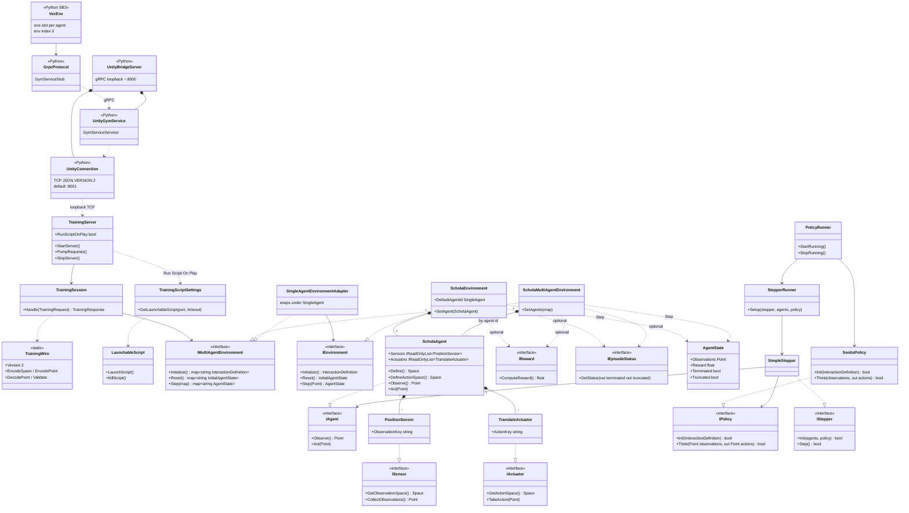
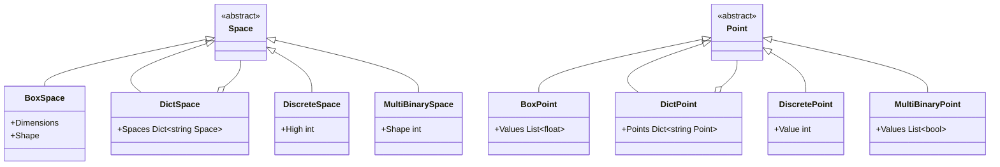
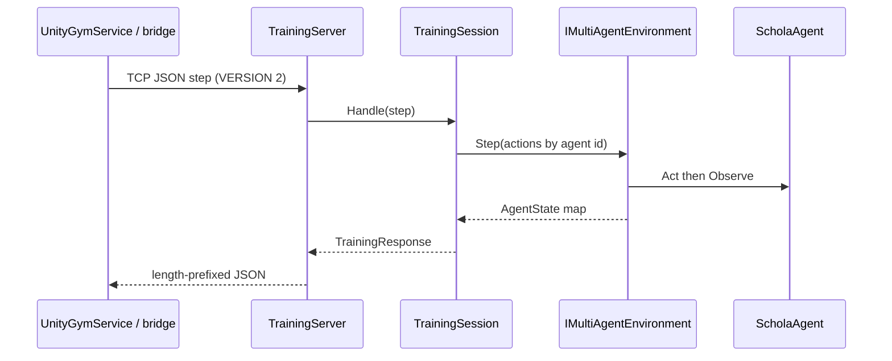

# AMD Schola Unity — architecture overview (UML)

Simplified view of US1–US5 on `main`: Runtime agents and environments, the Python↔Unity training bridge, and local inference. For exhaustive diagrams, sequences, and type inventory, see [`us1-us4-uml.md`](us1-us4-uml.md) (filename is historical; that file already covers US5).

**Shipped training path:** Python hosts `GymService` (gRPC, default ~8000); Unity hosts `TrainingServer` (TCP/JSON, default 8001, wire VERSION 2). States return on the wire. `ITrainingStateSink` exists on environments but is unused by the training connector. Optional Unity-hosted gRPC under `Training/Generated/` is tooling only.

---

## 1. Layered architecture

**Takeaway:** Runtime owns Observe/Act and episodes. Training reaches Runtime through Python’s gRPC adapter and Unity’s TCP session. Inference reuses the same agent loop without rewards, reset, or Python.

**Cardinality:** One Unity environment on the wire (index 0). Agents are keyed by id; the adapter injects `"SingleAgent"`. Python `GymEnv` stays one agent per env; `schola unity train` uses SB3 `VecEnv` and can train many agents on that single env (shared policy).

**Sensor/actuator lists:** `ScholaAgent` stores concrete `PositionSensor` / `TranslateActuator` lists, not `ISensor` / `IActuator`. New sensor or actuator types require an agent code change.

**Shared loop:** Training and inference both call `IAgent.Observe` / `IAgent.Act`. Only training uses environment reward, terminated/truncated, reset, and the wire protocol.

Sources: `Runtime/`, `Training/`, `Inference/`, `Resources/python/schola/unity/bridge.py`, `Resources/python/schola/scripts/unity.py`.

---

## 2. Space / Point model

**Takeaway:** Spaces describe legal shapes; points carry values. Default agents are Box leaves under Dict. Discrete and MultiBinary exist for nesting and the training wire; `SentisPolicy` has no MultiBinary.

Wire kinds: `"dict"` | `"box"` | `"discrete"` | `"multi_binary"`. Proto `MultiDiscrete` / `Text` are unimplemented in Unity.

Sources: `Runtime/Spaces/`, `Runtime/Points/`, `Training/TrainingWire.cs`.

---

## 3. One training step (behavioral anchor)

`TrainingSession` may autoreset when every agent is done. Environments do not auto-reset inside `Step`.

---

## 4. Unity vs Unreal (parity notes)

Short comparison for partner discussions (no full Unreal UML here):

1. **Environments** — Unity `IEnvironment` / `IMultiAgentEnvironment` mirror Unreal single- and multi-agent contracts; Unity wraps single-agent under `"SingleAgent"` via `SingleAgentEnvironmentAdapter`.
2. **Agent surface** — Unreal `IAgent` includes `Define` / status; Unity `IAgent` is Observe/Act only (`Define` is concrete on `ScholaAgent`).
3. **Reward / done** — Unreal fills reward and flags inside env `Step`; Unity splits them into optional `IReward` / `IEpisodeStatus` (no Runtime framework class; samples implement them).
4. **Connector** — Unreal hosts `GymService` in-process (`URPCGymConnector`); Unity ships TCP/JSON and lets Python `schola.unity.bridge` host `GymService`.
5. **Run Script On Play** — Same idea on both sides (`URPCGymConnector` ↔ `TrainingServer` + `LaunchableScript`): launch the trainer on Play, stop when the session ends.

---

## Legend

| Marker | Meaning |
| --- | --- |
| Solid types | On `main` in Runtime, Training, Inference, or Python bridge |
| `<<placeholder>>` | Contract with no Runtime framework class (`IReward`, `IEpisodeStatus`) |
| Dashed links | Optional binding or cross-process dependency |

`ITrainingStateSink` is omitted from the primary diagram; it remains an optional environment hook unused by the shipped connector.
