# US1–US5 Unity architecture (UML)

US1 (observations), US2 (actions), US3 (episodes), US4 (train through Schola), and US5 (run a trained policy) are implemented on `main`.

## Overview

The Unity package has three cooperating layers:

1. **Runtime agent and environment (US1–US3)** — Sensors collect observations, actuators apply actions, `ScholaAgent` aggregates them. `ScholaEnvironment` runs one agent; `ScholaMultiAgentEnvironment` runs many agents keyed by id. Both support optional reward and episode status.
2. **Training connection (US4)** — Python hosts Schola’s existing `GymService` gRPC API. A TCP/JSON bridge talks to Unity’s `TrainingServer` → `TrainingSession` → `TrainingWire` → `IMultiAgentEnvironment` (`ScholaMultiAgentEnvironment`, or `ScholaEnvironment` via `SingleAgentEnvironmentAdapter`). `TrainingServer` can optionally launch the Python trainer on Play (**Run Script On Play**, Unreal gRPC Gym Connector parity). Unity does **not** host `GymService` on the shipped path. Python `GymEnv` / `schola unity train` remain one agent per env.
3. **Local inference (US5)** — `PolicyRunner` / `SentisPolicy` drive the same `IAgent.Observe` / `IAgent.Act` loop without rewards, episode flags, or Python.

Both training and inference share the agent’s observation and action path. Only training uses the environment’s reward, terminated/truncated, reset, and wire protocol.

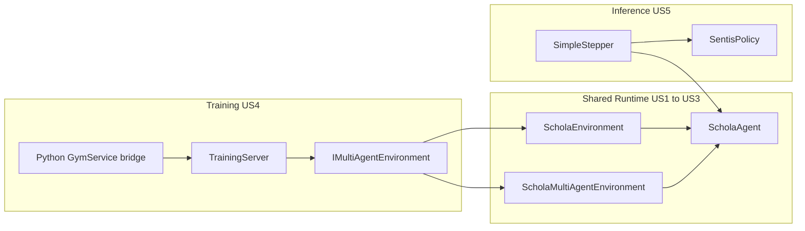

## Contents

1. [Legend](#legend)
2. [High-level architecture](#1-high-level-architecture)
3. [Observations and actions (US1–US2)](#2-observations-and-actions-us1us2)
4. [Episodes and environment (US3)](#3-episodes-and-environment-us3) ([multi-agent](#35-multi-agent-environment))
5. [Training through Schola (US4)](#4-training-through-schola-us4)
6. [Local inference (US5)](#5-local-inference-us5)
7. [Training vs inference](#6-training-vs-inference)
8. [Unity vs Unreal](#7-unity-vs-unreal)
9. [Type inventory](#8-type-inventory)

---

## Legend

| Marker | Mermaid cue | Meaning |
| --- | --- | --- |
| implemented | Solid box, no extra stereotype | Type on `main` in Runtime, Training, Inference, or Samples |
| placeholder | `<<placeholder>>` | Contract on `main` with no Runtime framework class (`IReward`, `IEpisodeStatus`, `ITrainingStateSink`) |
| Unreal | `<<Unreal>>` | Comparison type only; not a Unity type |
| optional / future | `<<optional>>` | Direct Unity `GymService`, `Training/Generated/`, or `-ScholaPort=` smoke contract — tooling only, not the shipped path |

Dashed associations mean optional, missing, or unused by the shipped training connector.

---

## 1. High-level architecture

**What to take away:** Unity Runtime owns agents and episodes. Training reaches that Runtime through Python’s gRPC adapter and Unity’s TCP server. Inference stays entirely inside Unity.

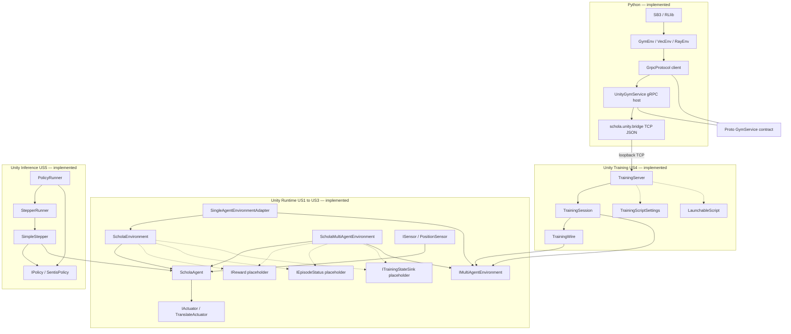

Shipped training entry: `schola unity train` starts `UnityGymService` (default gRPC port 8000) and a TCP client to `TrainingServer` (default port 8001). With **Run Script On Play**, entering Play Mode launches that trainer as a child process instead of using a terminal (skip with `-ScholaDisableScript`). States return in wire responses. `ITrainingStateSink` is unused by the training connector. Native Unity gRPC under `Training/Generated/` remains optional tooling. Python `GymEnv` remains one agent per env.

Sources: `Unity/com.amd.schola/Runtime/`, `Inference/`, `Training/`, `Training/README.md`, `Proto/GymConnector.proto`, `Resources/python/schola/unity/bridge.py`.

---

## 2. Observations and actions (US1–US2)

**What to take away:** Developers attach sensors and actuators to a `ScholaAgent`. The agent exposes Dict-shaped observation and action spaces/points. Default sensors/actuators are Box-only; Discrete and MultiBinary exist as data types for the wire and nesting under Dict.

### 2.1 Agent composition

`ScholaAgent` implements `IAgent` and stores **concrete** `List<PositionSensor>` / `List<TranslateActuator>` (exposed as `IReadOnlyList`), not `ISensor` / `IActuator`. Adding a new sensor or actuator type requires a code change on the agent.

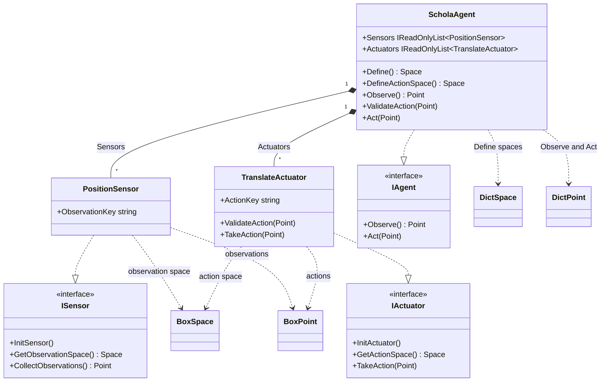

### 2.2 Spaces and points

Spaces describe legal shapes; points carry values. Dict types nest named child spaces/points. Training wire kinds: `"dict"` | `"box"` | `"discrete"` | `"multi_binary"`.

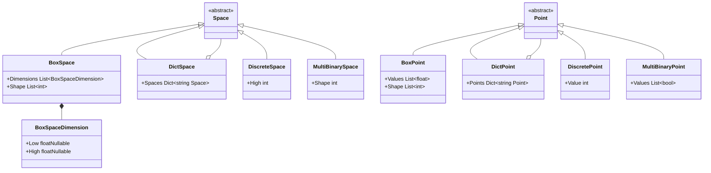

### 2.3 Behavior and limits

- `Define()` builds a `DictSpace` keyed by `PositionSensor.ObservationKey` (default `"position"`).
- `Observe()` builds a matching `DictPoint` of 3-float world `BoxPoint`s.
- `DefineActionSpace()` builds a `DictSpace` keyed by `TranslateActuator.ActionKey` (default `"translate"`). Duplicate keys warn and last-write-wins.
- `ScholaAgent.ValidateAction(Point)` and `TranslateActuator.ValidateAction(Point)` check payload shape without moving. `ValidateAction` is on the concrete types, not on `IAgent` / `IActuator`.
- `Act(Point)` calls `ValidateAction` first (requires a `DictPoint`, every actuator key present, each nested payload valid), then applies 3-float `BoxPoint` deltas via `TakeAction`. Wrong type or arity throws and leaves the scene unchanged.
- `MultiBinarySpace` / `MultiBinaryPoint` mirror Gymnasium `MultiBinary(n)` (`Shape`, `List<bool> Values`). They nest under Dict and round-trip on the training wire (`shape: [n]`, `boolValues`). There is no dedicated MultiBinary sensor or actuator; default agents stay Box-only. `SentisPolicy` does not support MultiBinary.
- Proto `MultiDiscrete` and `Text` remain unimplemented in Unity.
- No `Space.Contains` / bound enforcement on Runtime types; training validation lives in `TrainingWire.Validate`.
- Unity `IAgent` is Observe/Act only. It has no `Define` / `GetStatus` / `SetStatus` (those exist on Unreal `IAgent`; see [Unity vs Unreal](#7-unity-vs-unreal)). `ScholaAgent.Define` is a concrete method, not part of `IAgent`.

Sources: `Runtime/Sensors/`, `Runtime/Actuators/`, `Runtime/Agent/`, `Runtime/Points/`, `Runtime/Spaces/`, `Training/TrainingWire.cs`.

---

## 3. Episodes and environment (US3)

**What to take away:** `ScholaEnvironment` owns one `ScholaAgent`. `ScholaMultiAgentEnvironment` owns many agents keyed by id and returns maps from `Initialize` / `Reset` / `Step`. `AgentState` still has no agent-id field — the dictionary key is the identity. Reward, episode status, and the training-state sink are optional; the shipped training path does not use the sink.

### 3.1 Environment types

`IEnvironment.Step` takes one `Point` and returns one `AgentState` with no agent-id field. `IReward`, `IEpisodeStatus`, and `ITrainingStateSink` have no Runtime framework class; tests supply fakes. Sample `TrainingDemoTask` (`Samples~/`) implements `IReward` and `IEpisodeStatus`.

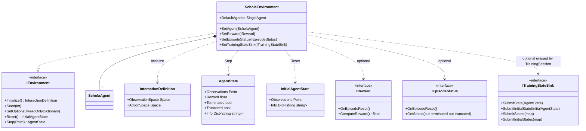

`IEnvironment` mirrors Unreal `ISingleAgentScholaEnvironment` with C# return values instead of out-params.

### 3.2 Step flow

Order inside `Step`: Act (which validates first) → reward → status → Observe → optional sink. The environment does **not** auto-reset; `TrainingSession` may reset around this call.

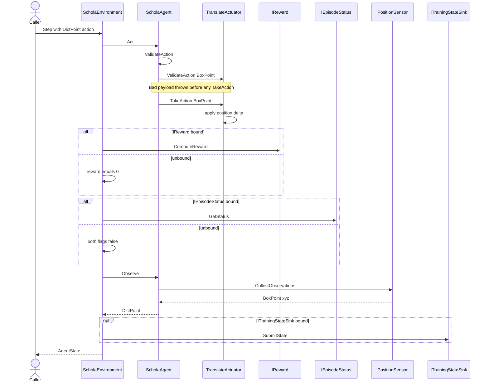

### 3.3 Reset flow

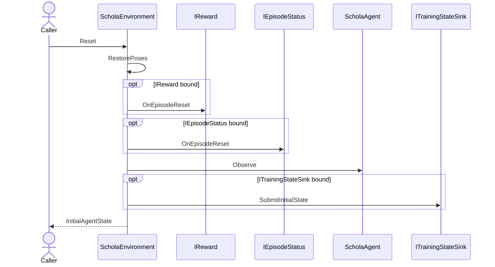

### 3.4 Single-agent behavior details

- `Initialize()` inits sensors/actuators, snapshots local poses of the agent hierarchy plus configured actuator transforms, and returns `InteractionDefinition(agent.Define(), agent.DefineActionSpace())`.
- `Reset()` calls `Initialize()` if not yet initialized, restores the snapshot, calls `OnEpisodeReset` on reward/status, observes, and returns `InitialAgentState` (obs + info only). No reward or done flags on reset.
- `Seed` and `SetOptions` are no-ops. `AgentState.Info` is allocated empty and never populated.
- Reward and status may be assigned in the inspector (`GetComponentInChildren`) or via setters. The sink is **not** auto-resolved; it must be `SetTrainingStateSink`. The shipped training connector does not set or use the sink. Singular sink methods: `SubmitState` / `SubmitInitialState`.

### 3.5 Multi-agent environment

**What to take away:** `IMultiAgentEnvironment` mirrors Unreal `IMultiAgentScholaEnvironment`. Maps are keyed by agent id. `ScholaMultiAgentEnvironment` is the native many-agent `MonoBehaviour`. `SingleAgentEnvironmentAdapter` presents one `IEnvironment` under `ScholaEnvironment.DefaultAgentId` (`"SingleAgent"`). `TrainingSession` stores `IMultiAgentEnvironment`; its `IEnvironment` constructor wraps through the adapter. Python `GymEnv` stays one agent per env.

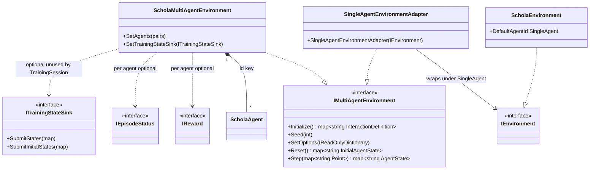

Multi-agent `Step` validates every live action before any agent moves. One bad, missing, unknown, or null action leaves every agent unmoved.

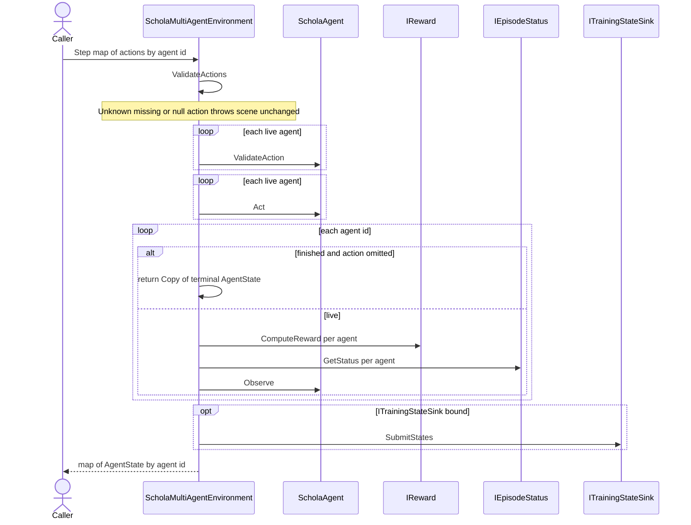

Behavior:

- Dictionary key is agent identity; `AgentState` / `InitialAgentState` have no agent-id field.
- Agent set is fixed by `Initialize`. Every `Reset` / `Step` returns one entry per those ids.
- No auto-reset after a terminal step; the caller (or `TrainingSession` autoreset) must call `Reset`.
- Finished agent: omit its action to keep a copy of the terminal state (hooks not called); send an action to revive and step. Matches Unreal `TScholaEnvironment::Step` / RLlib.
- Episode complete only when **every** agent is terminated or truncated.
- Config: non-empty unique ids; the same `ScholaAgent` cannot be registered twice; empty slots throw.
- Reward and status resolve per agent (component on the agent, then DFS children; nested `ScholaAgent` subtrees are skipped so a nested agent keeps its own hooks).
- `Reset` restores every initialize pose snapshot, clears finished agents, calls `OnEpisodeReset` on each agent's hooks, and optionally `SubmitInitialStates`.
- `SingleAgentEnvironmentAdapter` injects `DefaultAgentId = "SingleAgent"` (same key as Unreal's single-agent adapter) and implements the finished-agent omit/revive rule locally.
- The Python bridge forwards the agent ids Unity declares (env index `0`); it no longer injects `"SingleAgent"` itself.

Sources: `Runtime/Environment/`, `Runtime/TrainingDataTypes/`, `Runtime/Common/InteractionDefinition.cs`, `Samples~/TrainingDemo/Runtime/TrainingDemoTask.cs`.

---

## 4. Training through Schola (US4)

**What to take away:** Trainers speak the usual Schola `GymService` RPCs. Python hosts that gRPC service and translates to Unity TCP/JSON. Unity runs `TrainingServer` on the main thread against `IMultiAgentEnvironment`.

### 4.1 Shipped connection

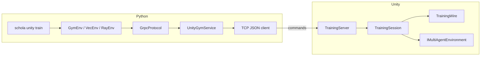

Roles:

1. **`TrainingServer`** — MonoBehaviour; loopback TCP (default port 8001); one request per `Update` on the main thread. Serves either `ScholaEnvironment` or `ScholaMultiAgentEnvironment`. Optionally launches a training script on Play via `TrainingScriptSettings` → `LaunchableScript`, and kills it in `StopServer` (see [§4.2](#42-run-script-on-play)).
2. **`TrainingSession`** — Commands `start`, `definition`, `reset`, `step`, `close` against `IMultiAgentEnvironment`. Autoreset: `0=SAME_STEP`, `1=NEXT_STEP`, `2=DISABLED`. The environment is done only when every agent is done.
3. **`TrainingWire`** — Version 2 JSON encode/decode/validate, with per-agent definition, action and state lists. Kinds: `"dict"` | `"box"` | `"discrete"` | `"multi_binary"` (`shape: [n]`, point `boolValues`).
4. **`schola.unity.bridge`** — Hosts `GymService` gRPC (default port 8000); maps proto ↔ TCP JSON using the agent ids Unity declared.

Python `UpdateState` still carries `Reset` or `Step`. The bridge maps those to Unity `reset` / `step`. Auto-reset is a `TrainingSession` concern; environments do not auto-reset. States return in the JSON response; `ITrainingStateSink` is unused.

Proto RPCs still used by trainers: `StartGymConnector`, `RequestTrainingDefinition`, `UpdateState`.

### 4.2 Run Script On Play

**What to take away:** When **Run Script On Play** is ticked, `TrainingServer` starts the TCP listener first, then launches a configured child process. Training output appears in the Console as `[Schola script] …`. Stopping Play Mode calls `StopServer`, which kills the process tree. This matches Unreal’s **Run Script On Play** on the gRPC Gym Connector. Types mirror Unreal `EScriptType`, `EPythonEnvironmentType`, `EPythonScript`, `FCustomTrainingSettings`, and `FTrainingScriptSettings` (Unity has no Built-in Python env).

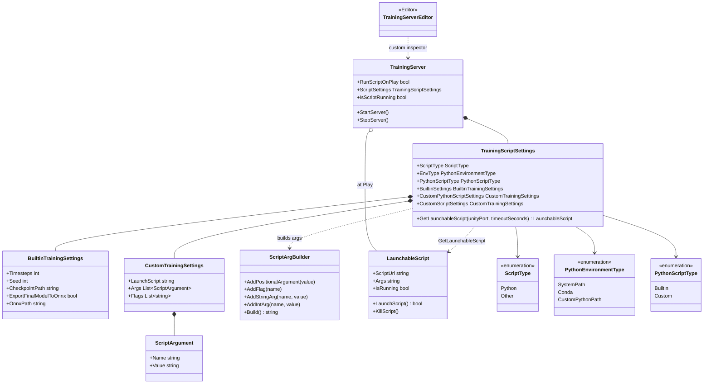

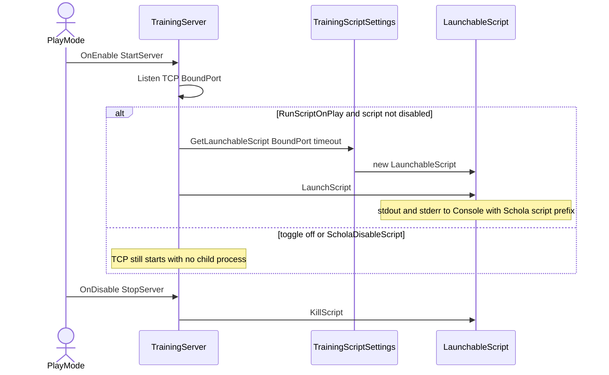

Behavior:

- Builtin Python script runs `python -m schola.scripts.launch unity train …` (or conda / custom Python). Every script also receives `--unity-port` and `--timeout`.
- **Python Env:** System PATH, Conda (env name), or Custom Python Path. **Script Type Other** launches any executable instead of Python.
- **Custom Training Script** / Other use `Args` as `--Name Value` and `Flags` as `--Flag`.
- `TrainingServerEditor` greys **Script Settings** until Run Script On Play is ticked and only shows fields for the chosen options. Pasted paths are trimmed of spaces and quotes.
- Pass `-ScholaDisableScript` on the command line to skip the launch without changing the inspector setting.

Sources: `Training/TrainingServer.cs`, `Training/TrainingScriptSettings.cs`, `Training/LaunchableScript.cs`, `Training/ScriptArgBuilder.cs`, `Training/Editor/TrainingServerEditor.cs`, `Documentation~/training.md`.

### 4.3 Protocol cardinality

**What to take away:** Proto and Unreal nest many envs and many agents. Unity’s shipped training stack is one env (index `0`) with one or many agents. `TrainingSession` drives `IMultiAgentEnvironment`. `ScholaMultiAgentEnvironment` returns `map<string, AgentState>` (and the matching definition and initial-state maps). `SingleAgentEnvironmentAdapter` injects the key `SingleAgent`, the same key Unreal's single-agent adapter uses, so a `ScholaEnvironment` stays one entry on that path. Python `GymEnv` still assumes 1 env, 1 agent. `GymVectorEnv` / SB3 flatten `(env, agent)` slots (shared spaces, finish together); `RayEnv` uses true multi-agent dicts.

Proto message nesting (identity lives in maps and repeated env slots):

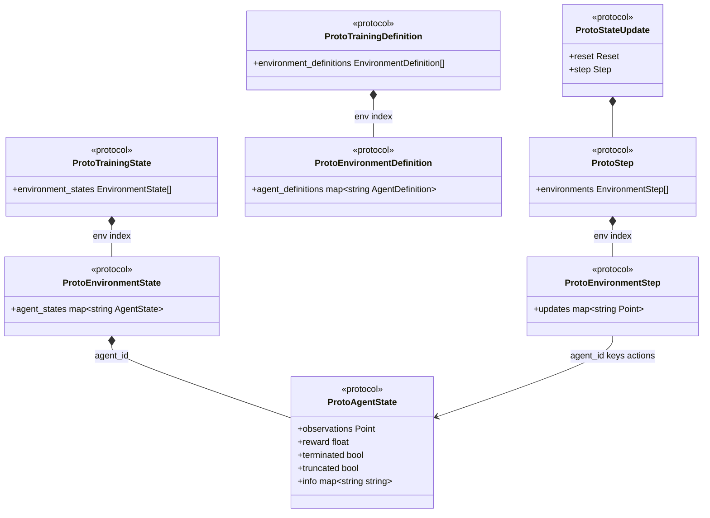

How Unity fits that nesting:

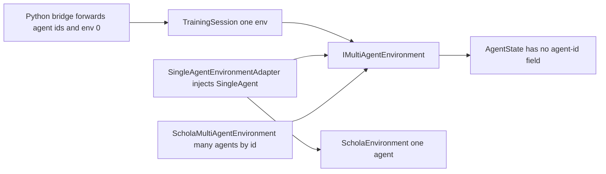

`IEnvironment` stays one agent. `SingleAgentEnvironmentAdapter` is what injects the key `SingleAgent` onto the `TrainingSession` path. `ScholaMultiAgentEnvironment` is the many-agent environment on that same path.

| Layer | Environments | Agents per env | How identity is keyed |
| --- | --- | --- | --- |
| Proto `TrainingState` / `TrainingDefinition` | Many (`repeated`) | Many (`map<string, …>`) | env index, then `agent_id` |
| Unreal `IScholaEnvironment` | Connector holds `TArray` of envs | Many (`TMap<FString, …>`) | `agent_id` string |
| Unreal `ISingleAgentScholaEnvironment` | One | One, adapter injects `"SingleAgent"` | injected key |
| Unity `ScholaEnvironment` | One | One | none on the C# state; adapter injects `"SingleAgent"` |
| Unity `TrainingSession` (US4) | One | One or many | JSON agent lists; bridge maps to proto keys |
| Unity `ScholaMultiAgentEnvironment` | One | Many | `agent_id` string |
| Unity `SingleAgentEnvironmentAdapter` | One | One | injected key `SingleAgent` |
| Python `GymEnv` | One | One | 1:1 wrap |
| Python `GymVectorEnv` / `sb3.VecEnv` | Many slots | Flattened `(env, agent)`; agents in one env finish together | slot index |
| Python `RayEnv` | Many | True multi-agent dicts | `agent_id` |
| Unity `SimpleStepper` (US5) | N/A | Many `IAgent`s, one `IPolicy` | list index, no episode |

No competitive/cooperative configs exist in Unity.

### 4.4 Optional direct gRPC (`<<optional>>`)

`Training/README.md` documents generating C# from `Proto/` into `Training/Generated/` and a future `-ScholaPort=` player smoke contract that would host `GymService` inside Unity (matching Unreal). That path is **not required** by the shipped TCP-plus-adapter implementation and has no committed generated baseline.

### 4.5 Historical notes

Current tree is the authority. Context only:

1. **`origin/US4`** — native gRPC spike: generated proto C# plus `GymStartupServer` implementing `StartGymConnector` only. Step/reset unimplemented.
2. **PR #17 / revert PR #18** — early TCP + JSON bridge was reverted, then restored and completed as the shipped `TrainingServer` / `TrainingSession` / `TrainingWire` + `schola.unity.bridge` path. It calls `IEnvironment` directly and does not implement `ITrainingStateSink`.

Sources: `Proto/GymConnector.proto`, `Proto/State.proto`, `Proto/Definitions.proto`, `Proto/StateUpdates.proto`, `Training/README.md`, `Training/TrainingServer.cs`, `TrainingSession.cs`, `TrainingWire.cs`, `Resources/python/schola/unity/bridge.py`, `Resources/python/schola/gym/env.py`.

---

## 5. Local inference (US5)

**What to take away:** Load an ONNX model in Unity and drive agents without Python. Same Observe/Act path as training; no reward, terminated/truncated, reset, or training sink.

### 5.1 Components

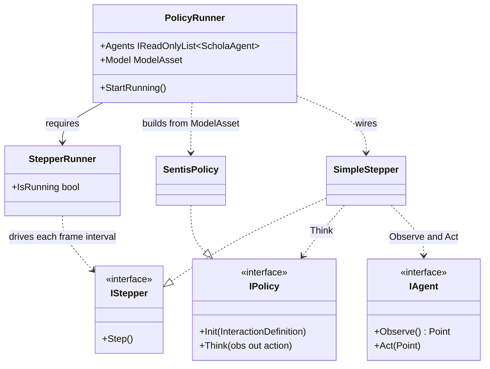

`PolicyRunner` is the inspector entry: assign agents and a `ModelAsset`, enter Play Mode. It builds `SentisPolicy`, wraps agents in `SimpleStepper`, and starts `StepperRunner`.

`SentisPolicy` supports Dict spaces with **Box** observations and **Box or Discrete** actions. It does **not** support MultiBinary. `SimpleStepper` can drive many `IAgent`s with one shared `IPolicy` (inference-only multi-agent by list index, not a training multi-agent environment).

### 5.2 Inference step flow

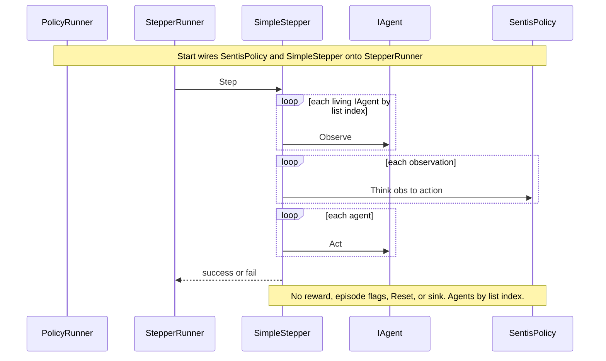

Sources: `Inference/PolicyRunner.cs`, `Inference/SentisPolicy.cs`, `Runtime/Steppers/SimpleStepper.cs`, `Runtime/Steppers/StepperRunner.cs`, `Runtime/Policies/IPolicy.cs`.

---

## 6. Training vs inference

Both loops share `IAgent.Observe` / `IAgent.Act`. Only the environment/training path has reward, episode flags, reset, and the wire protocol.

| Concern | Training (US3 + US4) | Inference (US5) |
| --- | --- | --- |
| Entry | `TrainingServer` / `TrainingSession` or direct `ScholaEnvironment` | `PolicyRunner` / `StepperRunner` |
| Action source | Python trainer via bridge | `SentisPolicy.Think` |
| Reward / terminated / truncated | Yes, via optional `IReward` / `IEpisodeStatus` | No |
| Reset | Env `Reset` (single or multi); autoreset in `TrainingSession` | No |
| Agent identity | Unity-declared agent ids (adapter injects `"SingleAgent"`) | List index |
| Multi-agent | `ScholaMultiAgentEnvironment` on the training path | Inference-only many agents, one policy |
| MultiBinary on wire | Supported in `TrainingWire` + bridge | Not supported in `SentisPolicy` |

---

## 7. Unity vs Unreal

**What to take away:** Unity mirrors Unreal’s single- and multi-agent environment contracts, splits reward/status into interfaces, keeps `IAgent` minimal, and ships TCP/JSON instead of in-process `GymService`.

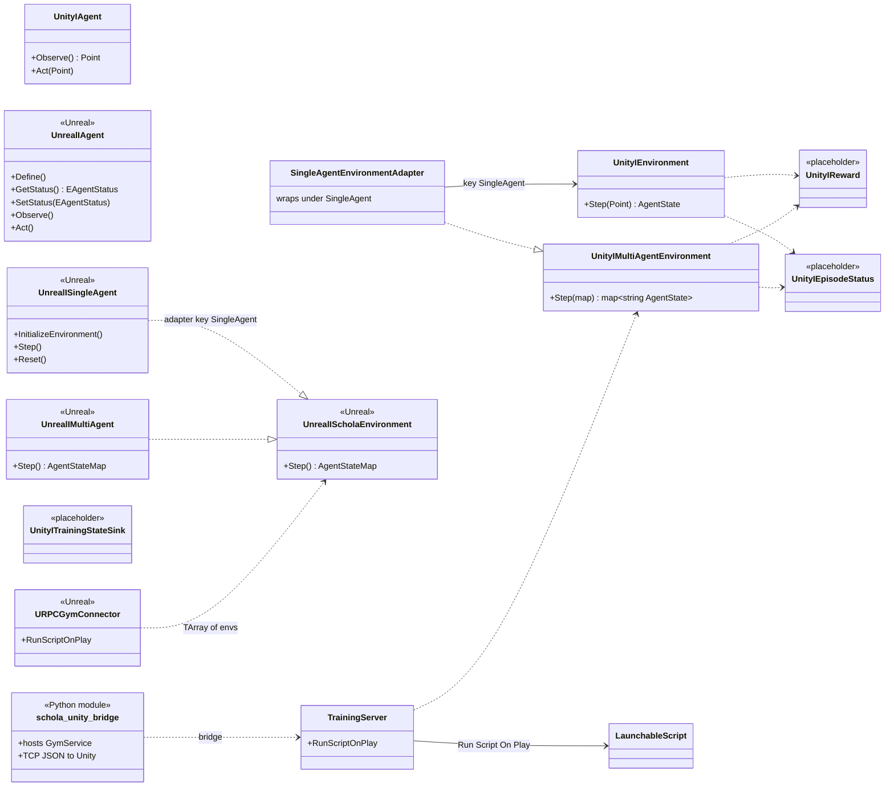

Differences that matter for Unity training:

- Unreal `IAgent` also has `Define`, `GetStatus`, `SetStatus`. Unity `IAgent` is Observe/Act only; `ScholaAgent.Define` is concrete.
- Unreal environments fill `FAgentState.Reward` / `bTerminated` / `bTruncated` inside `Step`. They have no `IReward` / `IEpisodeStatus`.
- Unity `IMultiAgentEnvironment` matches Unreal `IMultiAgentScholaEnvironment`: maps keyed by agent id, with reward and episode flags filled per agent inside `Step`. `TrainingSession` drives that multi-agent interface; a single-agent environment is wrapped by `SingleAgentEnvironmentAdapter`.
- Unreal hosts `GymService` via `URPCGymConnector` / `UCommunicationManager`. Unity hosts TCP JSON; Python `schola.unity.bridge` hosts `GymService`.
- Unreal **Run Script On Play** on `URPCGymConnector` ↔ Unity on `TrainingServer`: both can launch the trainer on Play and stop it when the session ends. Unity still does not host `GymService` in-process.

Sources: `Source/Schola/Public/Agent/AgentInterface.h`, `Source/ScholaTraining/Public/Environment/`, `Source/ScholaProtobuf/Public/GymConnectors/gRPC/gRPCGymConnector.h`.

---

## 8. Type inventory

| Type | Story | Status | Notes |
| --- | --- | --- | --- |
| `ISensor` | US1 | implemented | `InitSensor`, `GetObservationSpace`, `CollectObservations` |
| `PositionSensor` | US1 | implemented | 3-float world `BoxPoint`, key `"position"` |
| `IActuator` | US2 | implemented | `InitActuator`, `GetActionSpace`, `TakeAction` |
| `TranslateActuator` | US2 | implemented | 3-float `BoxPoint` delta; `ValidateAction` then `TakeAction` |
| `IAgent` | US1–US2 | implemented | Observe / Act only |
| `ScholaAgent` | US1–US2 | implemented | Concrete sensor/actuator lists; `ValidateAction` before `Act` |
| `Point` / `BoxPoint` / `DictPoint` / `DiscretePoint` | US1–US2 | implemented | No MultiDiscrete or Text |
| `MultiBinaryPoint` | US1–US4 | implemented | `List<bool> Values`; training wire + bridge; no Sentis |
| `Space` / `BoxSpace` / `DictSpace` / `DiscreteSpace` | US1–US2 | implemented | No `Contains` / bound enforcement on Runtime types |
| `MultiBinarySpace` | US1–US4 | implemented | `Shape` = Gymnasium `MultiBinary(n)`; wire kind `multi_binary` |
| `IEnvironment` | US3 | implemented | Mirrors Unreal `ISingleAgentScholaEnvironment` |
| `ScholaEnvironment` | US3 | implemented | One `ScholaAgent`; `Seed` / `SetOptions` no-ops |
| `IReward` | US3 | placeholder | No Runtime class; test fakes; sample `TrainingDemoTask` |
| `IEpisodeStatus` | US3 | placeholder | Independent terminated / truncated; sample `TrainingDemoTask` |
| `AgentState` / `InitialAgentState` | US3 | implemented | Hand-written proto mirrors; no agent-id field |
| `InteractionDefinition` | US3 | implemented | ObservationSpace + ActionSpace |
| `ITrainingStateSink` | US4 | placeholder | Singular submit plus `SubmitStates` / `SubmitInitialStates` for agent-id maps; unused by the training connector |
| `TrainingServer` | US4 | implemented | Loopback TCP; one request per `Update`; optional Run Script On Play |
| `TrainingScriptSettings` | US4 | implemented | Script type, Python env, builtin/custom args; builds `LaunchableScript` |
| `BuiltinTrainingSettings` | US4 | implemented | Timesteps, seed, checkpoint, ONNX export for builtin `schola … unity train` |
| `CustomTrainingSettings` | US4 | implemented | Launch path plus `--Name Value` args and `--Flag` flags |
| `ScriptArgument` | US4 | implemented | Name/value pair for custom scripts |
| `LaunchableScript` | US4 | implemented | Hidden child process; Console output; kill process tree |
| `ScriptArgBuilder` | US4 | implemented | Fluent `--name value` / flags; quotes paths with spaces |
| `ScriptType` / `PythonEnvironmentType` / `PythonScriptType` | US4 | implemented | Enums mirroring Unreal script settings (no Built-in Python) |
| `TrainingServerEditor` | US4 | implemented | Custom inspector; greys script settings until Run Script On Play |
| `TrainingSession` | US4 | implemented | Speaks `IMultiAgentEnvironment`; autoreset when every agent is done |
| `TrainingWire` | US4 | implemented | Version 2 per-agent lists; JSON encode/decode/validate including `multi_binary` |
| Python `schola.unity.bridge` | US4 | implemented | Hosts `GymService`; forwards Unity agent ids; TCP JSON ↔ proto |
| `IPolicy` / `SentisPolicy` | US5 | implemented | Local ONNX; Box obs; Box/Discrete actions; no MultiBinary |
| `PolicyRunner` | US5 | implemented | Inspector entry: agents + `ModelAsset` → Sentis + stepper |
| `IStepper` / `SimpleStepper` / `StepperRunner` | US5 | implemented | Observe-think-act; no reward or reset |
| Unity-hosted `GymService` | US4 | optional | Direct gRPC / `Training/Generated/` / `-ScholaPort=`; not shipped |
| `IMultiAgentEnvironment` | multi-agent | implemented | Mirrors Unreal `IMultiAgentScholaEnvironment`; maps keyed by agent id; omit action to keep terminal state, send action to revive |
| `ScholaMultiAgentEnvironment` | multi-agent | implemented | Many `ScholaAgent`s by id; validates all actions before any `Act`; per-agent reward/status; on `TrainingSession` path |
| `SingleAgentEnvironmentAdapter` | multi-agent | implemented | Wraps `IEnvironment` under `DefaultAgentId` (`SingleAgent`) for `TrainingSession` |
| `IMultiAgentScholaEnvironment` | Unreal | Unreal | Comparison type. Unity equivalent is `IMultiAgentEnvironment` |
